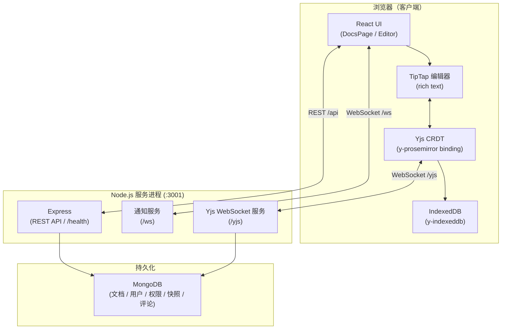

# NexaDoc

> 实时多人协同文档编辑器 —— 基于 React + TipTap、Yjs CRDT、Express/WebSocket 与 MongoDB 构建。


---

## 🚀 快速开始

当前主线实现位于 `client/`（React + Vite + TipTap）与 `server/`（Express + ws + MongoDB）。

### 方式一：Docker 一键启动（推荐）

```bash
cp .env.example .env      # 可选：覆盖端口、JWT 密钥
# PowerShell: Copy-Item .env.example .env
docker compose up --build # → http://localhost:3001
```

- 单镜像同源部署：Express 同时提供前端静态资源与 `/api`、`/yjs`、`/ws`（见 `server/src/server.ts`）
- 健康检查：`curl http://localhost:3001/health` → `{"status":"ok",...}`
- 数据落在 Docker volume `mongo-data`；`docker compose down -v` 可清空
- 宿主 3001 被本地 dev 占用时：`APP_PORT=8080 docker compose up --build`

### 方式二：本地开发（热更新）

```bash
# 1) MongoDB（任选其一：本地装/容器）
docker run -d --name mongo -p 27017:27017 mongo:7

# 2) 后端 :3001
cd server && npm ci && npm run dev

# 3) 前端 :5173（Vite 代理 /api、/yjs、/ws 到 :3001）
cd client && npm ci && npm run dev
```

访问 <http://localhost:5173>。

### 测试

```bash
cd server && npm test          # Vitest（mongodb-memory-server，不动本地库）
cd client && npm test          # Vitest + Testing Library
cd client && npm run test:e2e  # Playwright（自动拉起 dev 双服务）

# 针对已部署的栈跑 e2e：
#   bash: PLAYWRIGHT_BASE_URL=http://localhost:3001 npx playwright test
#   PowerShell: $env:PLAYWRIGHT_BASE_URL="http://localhost:3001"; npx playwright test
docker compose -f compose.yml -f compose.e2e.yml run --rm e2e   # 或在容器内跑
```

### 分离部署（可选）

```bash
docker compose -f compose.split.yml up --build   # nginx(:8080) + node(:3001) + mongo
```

> 构建镜像时若 Docker Desktop 刚重启过，可能因继承 Windows 系统代理而拉不动镜像/装依赖：
> 先临时关闭系统代理并重启 Docker（`docker info` 看到内部代理 `http.docker.internal:3128` 即正常）。

---

## ✨ 功能特性

| 类别 | 说明 |
|---|---|
| **实时协同编辑** | 基于 Yjs CRDT 实现无冲突并发编辑，变更在所有在线用户间即时同步 |
| **在线状态感知** | 协作者头像（仅显示其他用户）、输入状态指示器、带用户颜色的命名光标；用户离开后立即清除 |
| **文档标题同步** | 在编辑器标题栏重命名文档时，通过 Yjs awareness 实时广播到所有打开的标签页 |
| **富文本编辑** | 13 种字体、15 种字号（8 pt – 72 pt）、加粗/斜体/下划线/删除线、字体颜色与高亮、对齐方式、有序/无序列表、缩进、超链接 |
| **文档管理** | 创建（自定义名称，即时显示在编辑器中）、重命名、搜索、删除 —— 全部通过内联模态框完成（不使用浏览器 `prompt()`） |
| **离线支持** | 通过 `y-indexeddb` 实现 IndexedDB 本地持久化；断网后自动重连并同步 |
| **导出** | 一键导出 PDF（`html2pdf.js`）和 DOCX（`file-saver`） |
| **字数统计** | 编辑器状态栏实时显示字数和字符数 |
| **响应式界面** | 适配桌面、平板和移动端 |

---

## 🏗️ 架构



> **单进程服务**：后端为单一 Node.js 进程（端口 3001），提供：
> - Express REST API（`/api/*`）与 `/health` 健康检查路由
> - Yjs WebSocket 同步服务（`/yjs`），基于 y-websocket 实现 CRDT 实时同步
> - 通知 WebSocket 服务（`/ws`），用于共享邀请等实时通知
> - MongoDB 持久化（文档 CRDT 状态、用户、权限、快照、评论）

---

## 📁 项目结构

```
nexadoc/
│
├── client/                         # Vite + React 前端
│   ├── index.html                  # 应用入口 HTML
│   ├── vite.config.ts              # Vite 配置（含 /api 代理）
│   ├── package.json
│   └── src/
│       ├── main.tsx                # React DOM 入口
│       ├── App.tsx                 # 路由：/ → DocsPage，/document/:id → Editor
│       ├── index.css               # 设计系统（CSS 变量、字体、编辑器样式）
│       │
│       ├── types/index.ts          # 共享类型定义（RBAC 角色、文档接口等）
│       │
│       ├── components/
│       │   ├── DocsPage.tsx        # 主页 —— 文档列表、搜索、创建/删除模态框
│       │   ├── Editor.tsx          # 编辑器 —— TipTap + Yjs 绑定、工具栏、导出
│       │   ├── EditorToolbar.tsx   # 编辑器工具栏
│       │   ├── LoginPage.tsx       # 登录页
│       │   ├── RegisterPage.tsx    # 注册页
│       │   ├── CommentPanel.tsx    # 评论面板
│       │   ├── ShareModal.tsx      # 分享模态框
│       │   └── VersionHistoryModal.tsx  # 版本历史模态框
│       │
│       ├── contexts/
│       │   └── AuthContext.tsx     # 认证上下文（登录/注册/登出状态管理）
│       │
│       ├── services/
│       │   ├── api.ts              # REST API 封装
│       │   ├── yjsProvider.ts      # Yjs 文档 + IndexedDB + WebSocket Provider
│       │   └── storage.ts          # localStorage 辅助函数
│       │
│       ├── extensions/
│       │   └── FontSize.ts         # TipTap 自定义字号扩展
│       │
│       └── utils/
│           └── generateId.ts       # 从文档名生成确定性 slug ID
│
├── server/                         # Node.js + Express + ws + Yjs 后端
│   ├── src/
│   │   ├── server.ts               # 主服务 —— Express、Yjs WS、静态托管、优雅退出
│   │   ├── db.ts                   # MongoDB 连接管理
│   │   ├── auth.ts                 # JWT 签发与校验
│   │   ├── rbac.ts                 # RBAC 角色与能力契约（getAbilities）
│   │   ├── persistence.ts          # Yjs 文档持久化（MongoDB 读写）
│   │   ├── notifications.ts        # 实时通知服务
│   │   ├── docId.ts                # docId 编码与规范化
│   │   ├── types.ts                # 共享类型定义
│   │   └── routes/
│   │       ├── documents.ts        # 文档 CRUD 路由
│   │       ├── sharing.ts          # 分享与权限路由
│   │       ├── snapshots.ts        # 版本快照路由
│   │       └── comments.ts         # 评论路由
│   └── package.json
│
├── docs/                           # 项目文档
│   ├── 选题提案.md                  # 课程选题提案（归档）
│   ├── UPGRADE_PLAN.md             # 升级计划
│   ├── 阶段一/                      # 阶段一文档（架构升级计划与变更记录）
│   ├── 阶段二/                      # 阶段二文档（持久化/分享/评论计划）
│   └── 阶段三/                      # 阶段三文档（测试/容器化/CI 计划）
│
├── Dockerfile                      # 统一多阶段构建（client build + server runtime）
├── compose.yml                     # 一键启动：app + mongo
├── compose.split.yml               # 分离部署：nginx + node + mongo
├── compose.e2e.yml                 # e2e 测试容器
└── .env.example                    # 环境变量模板
```

---

## ⚙️ 环境要求

| 工具 | 最低版本 |
|---|---|
| Node.js | 18.x |
| npm | 9.x |

---

## 🌍 环境变量

### 客户端（`client/`）

本地开发时创建 `client/.env.local` 文件：

```env
VITE_API_URL=http://localhost:3001
VITE_YJS_URL=ws://localhost:3001/yjs
```

生产环境示例：

```env
VITE_API_URL=https://your-domain.com
VITE_YJS_URL=wss://your-domain.com/yjs
```

### 服务端（`server/`）

| 变量 | 默认值 | 说明 |
|---|---|---|
| `PORT` | `3001` | 服务监听端口 |
| `MONGO_URI` | `mongodb://localhost:27017` | MongoDB 连接地址 |
| `DB_NAME` | `nexadoc` | MongoDB 数据库名 |
| `JWT_SECRET` | `dev-secret-change-in-production` | JWT 签名密钥（生产必须替换） |
| `CLIENT_ORIGIN` | `http://localhost:5173` | 前端 CORS 白名单地址 |
| `CLIENT_DIST` | 不设置 | 前端静态资源目录（生产同源部署时设为 `/app/public`） |

---

## 🔄 实时同步流程

```
用户在 TipTap 编辑器中输入
      ↓
TipTap 编辑器触发 update 事件
      ↓
Yjs CRDT 在本地合并变更（无冲突）
      ↓
y-websocket 将 update 发送到服务端 (:3001/yjs)
      ↓
服务端广播 update 到同一文档房间内的所有客户端
      ↓
其他客户端通过 Yjs 应用变更（同时更新 IndexedDB）
      ↓
TipTap 重新渲染文档内容
```

---

## 🧩 核心模块

### `client/src/components/Editor.tsx`
应用核心组件，职责包括：
- 使用 TipTap 编辑器实现富文本编辑，支持自定义字号扩展
- 通过 `y-prosemirror` 将 TipTap 与 Yjs CRDT 绑定，实现实时协同
- 管理 Yjs `awareness` 实现协作者光标和输入状态感知
- 标题同步 —— 标题变更通过 `awareness` 广播到所有打开的标签页
- 顶栏包含返回导航、可编辑标题、协作者头像、连接状态、模式切换与导出按钮
- 实时字数和字符数统计

### `client/src/components/DocsPage.tsx`
文档主页，职责包括：
- 列出用户拥有的和被分享的文档
- 文档名称全文搜索
- 内联模态框创建新文档（替代 `window.prompt`）
- 删除确认模态框
- 带相对时间戳的彩色文档卡片

### `client/src/services/yjsProvider.ts`
创建并配置 Yjs 协同栈：
- `Y.Doc` —— 共享 CRDT 文档
- `IndexeddbPersistence` —— 本地离线持久化
- `WebsocketProvider` —— 通过 y-websocket 实现实时同步

### `server/src/server.ts`
Express + Yjs WebSocket 主服务：
- `/health` 健康检查端点（含数据库连接状态）
- `/api/*` REST API 路由（文档、分享、快照、评论）
- `/yjs` Yjs WebSocket 同步服务（含 JWT 认证与权限检查）
- `/ws` 通知 WebSocket 服务
- 生产模式下托管前端静态资源
- 支持 SIGTERM/SIGINT 优雅退出（flush 文档状态后关闭连接）

### `server/src/rbac.ts`
RBAC 权限模型：
- 定义角色层级：reader → commenter → editor → administrator → owner
- `getAbilities(role)` 返回能力契约（canView / canEdit / canDelete / canShare / canComment / canViewHistory）
- 前端直接消费布尔值控制 UI 显示与隐藏

---

## 🖥️ 支持的字体

字号范围为 **8 pt 到 72 pt**（标准文档 pt 单位），共 15 档可选。

| 字体 | 分类 |
|---|---|
| Arial | 无衬线 |
| Times New Roman | 衬线 |
| Roboto | 无衬线 |
| Open Sans | 无衬线 |
| Lato | 无衬线 |
| Montserrat | 无衬线 |
| Poppins | 无衬线 |
| Raleway | 无衬线 |
| Ubuntu | 无衬线 |
| Playfair Display | 展示衬线 |
| Merriweather | 衬线 |
| Source Code Pro | 等宽 |
| Nunito | 圆角无衬线 |

---

## 🔧 可用脚本

### 客户端（`client/`）

| 脚本 | 说明 |
|---|---|
| `npm run dev` | 启动 Vite 开发服务器（热更新） |
| `npm run build` | 构建生产包 |
| `npm run preview` | 本地预览生产构建 |
| `npm run lint` | 运行 ESLint |
| `npm test` | 运行 Vitest 单元测试 |
| `npm run test:e2e` | 运行 Playwright e2e 测试 |

### 服务端（`server/`）

| 脚本 | 说明 |
|---|---|
| `npm run dev` | 启动开发服务（热更新） |
| `npm start` | 启动生产服务 |
| `npm test` | 运行 Vitest 单元测试与接口测试 |
| `npm run build` | 编译 TypeScript 到 `dist/` |

---

## 🚧 已知限制与后续计划

- **服务端模块化** —— 当前 `server/src/` 为平铺结构，后续可按域拆分为 `modules/` 目录
- **链接分享** —— 当前仅支持按用户名邀请，后续可增加链接分享与"任何人可访问"模式
- **CI/CD** —— `.github/workflows/` 已预留，后续补充 lint/test/build 流水线
- **国际化** —— 前端文案为硬编码中文，后续可引入 `react-i18next` 搭建多语言框架
- **暗色模式** —— CSS 变量已就位，后续可添加主题切换

---

## 🤝 贡献

1. Fork 本仓库
2. 创建功能分支：`git checkout -b feat/your-feature`
3. 提交变更：`git commit -m 'feat: add your feature'`
4. 推送：`git push origin feat/your-feature`
5. 发起 Pull Request

请遵循 [Conventional Commits](https://www.conventionalcommits.org/) 规范。

---

## 📄 许可证

[MIT](./LICENSE)
