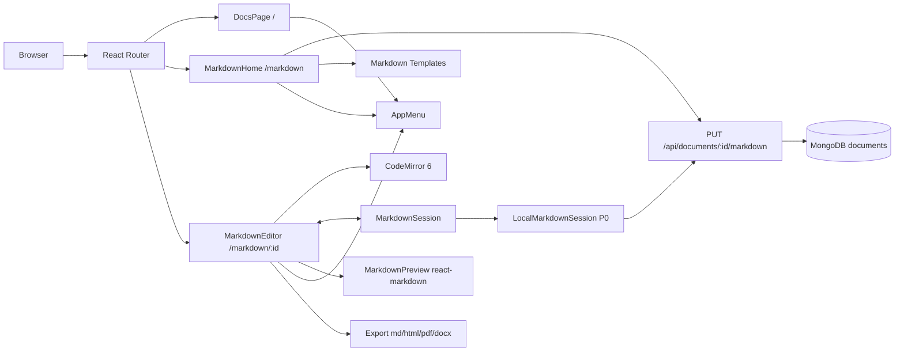
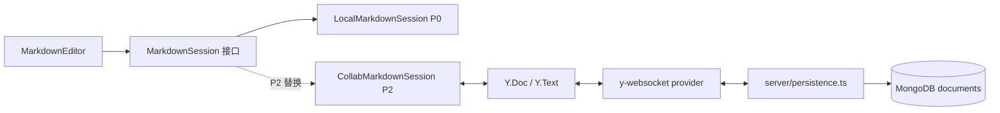

# 阶段四详细计划：Markdown 编辑器、标签、全文检索、双链与导出（P0 实时预览 / P2 分享与协作）

> **版本**：v1.1（2026-10-17）
> **状态**：待评审
> **目标读者**：项目组 3 名开发（A/B/C）
> **排期假设**：3 名开发共同推进。P0 4 周（建议 2026-10-19 ~ 2026-11-13）；P2 再加 2 周。
> 若每人每天投入不足 3 小时，整体按 6 周 + P2 3 周顺延；P0 功能范围不变。
>
> **v1.1 调整**：
> - 明确 Markdown 编辑器 = **左侧源码 + 右侧实时预览**，默认 50/50 分栏。
> - Markdown 主页 **复用现有 Word/Docs 主页的布局与视觉**（顶部栏、模板区、最近文档网格、搜索、空状态）。
> - **分享与多人实时编辑移到 P2**；P0 先做单用户编辑器，但保留升级接口、数据字段和迁移方案，P2 不是“以后再说”。
> - **交互修订（2026-10-19）**：汉堡菜单用于工作区切换及通用入口；新建文档和搜索仅集成于 Markdown 主页，不在菜单中提供快捷项。

---

## 0. 一页结论

1. **新增文档类型 `markdown`**，不把富文本原地转换；两类文档共用权限、MongoDB、分享/协作基础设施，但编辑器和路由独立。
2. **入口对齐 Google Docs**：左上角 `☰` → `Docs` / `Markdown` → 进入对应主页；当前类型打勾。
3. **P0 的 Markdown 编辑器是“实时预览编辑器”**：左 CodeMirror 源码、右 react-markdown 预览，输入后 80–150ms 更新；支持源码/分栏/预览三种布局。
4. **P0 的 Markdown 主页与现有 Word 主页同构**：同样的顶部栏、`Start a new document` 模板区、`My documents` 卡片网格、搜索框、空状态；只是模板和卡片内容换成 Markdown。
5. **P0 是单用户编辑**：CodeMirror 本地状态 + 800ms 防抖 `PUT` 保存 + 草稿恢复 + 修订号冲突检测；不显示 Share 按钮，Markdown 文档默认仅 owner 可访问。
6. **分享与多人实时编辑放 P2，但已经预留升级路径**：
   - 客户端用 `MarkdownSession` 接口隔离“本地单用户”和“Yjs 协作”两种实现；
   - 服务端保留 `crdtState` 字段和 `persistence.ts` 扩展点；
   - P2 打开 `MARKDOWN_SHARING_ENABLED` / `MARKDOWN_COLLAB_ENABLED` 两个开关即可逐步启用。
7. **P0 范围**：实时分栏预览、Markdown 主页、标签、全文检索、双链/反链、四种导出、单用户自动保存。
8. **P2 范围**：ShareModal/RBAC 分享、共享列表、多人实时编辑、远程光标、只读协作、离线重连。
9. **三人分工**：
   - **A：后端/数据/搜索/双链 + 技术协调**（API 契约、集成分支维护、服务端测试）
   - **B：Markdown 编辑器内核**（CodeMirror + 实时预览 + 自动保存 + 双链补全）
   - **C：主页/检索与双链 UI/导出/QA + 交付协调**（菜单、路由、主页复用、搜索、反链、导出、e2e、看板/演示）

---

## 1. 目标与非目标

### 1.1 目标

| 编号 | 需求 | 优先级 | 验收结果 |
|---|---|---|---|
| R1 | 新增 Markdown 编辑器 | P0 | 新建/打开 Markdown 文档，左侧源码、右侧实时预览 |
| R2 | 像 Google Docs 一样切换 | P0 | 左上角汉堡菜单列出 Docs / Markdown，选择后进入对应主页 |
| R3 | 实时预览 | P0 | 输入后 80–150ms 内右侧预览更新，滚动大致同步 |
| R4 | Markdown 主页与 Word 主页一致 | P0 | 顶部栏、模板区、最近文档网格、搜索、空状态与 DocsPage 同构 |
| R5 | 标签 | P0 | 文档可增删标签，按标签筛选，标签计数 |
| R6 | 全文检索 | P0 | 按标题、正文、标签搜索 Markdown 文档，返回高亮摘要 |
| R7 | 双链引用 | P0 | `[[文档标题]]` 可点击跳转，自动补全，反向链接面板 |
| R8 | 导出 | P0 | 导出 `.md`、`.html`、`.pdf`、`.docx`，内容与预览一致 |
| R9 | 不破坏现有功能 | P0 | 富文本编辑器、分享、权限、现有测试全部保持通过 |
| R10 | 分享 + 多人实时编辑 | **P2** | 分享角色、共享列表、双人同步、远程光标、只读协作 |

### 1.2 非目标

**P0 明确不做**：
- 分享按钮、分享链接、Markdown 的 `document_access` 分享 UI。
- 多人实时编辑、远程光标、在线状态。
- Markdown 评论锚定与评论侧栏。
- Markdown 版本历史 UI（现有快照依赖 TipTap JSON）。
- 图片/附件上传（只支持外链图片）。
- 富文本与 Markdown 的**原地**互转。
- 移动端原生 App、i18n、暗色主题。
- 全文检索集群（Meilisearch/Atlas Search）。

**P2 做**：
- ShareModal、角色（reader/commenter/editor/owner）、共享列表、权限通知。
- Yjs + y-websocket 多人实时编辑、远程光标、presence、只读拦截、离线重连。

**P3 可选**：
- Markdown 评论锚定、版本历史、图片上传、`另存为 Markdown`、导入 `.md`、更多模板。

---

## 2. 需要团队拍板的产品决策

| 编号 | 决策 | 推荐方案 | 理由 |
|---|---|---|---|
| D1 | 文档类型是否可切换 | **类型固定**：创建时选择 `rich` / `markdown`，之后不可原地切换 | 两种格式的 Yjs 结构不同；原地转换会丢失格式。Docs/Sheets 也是不同文档类型 |
| D2 | 菜单行为 | 菜单是**工作区切换**：`Docs` → `/`，`Markdown` → `/markdown`；当前类型打勾 | 与 Google Docs 一致 |
| D3 | Markdown 编辑布局 | **默认左右 50/50 分栏**：左源码、右实时预览；支持 Source / Split / Preview 三态 | 符合产品需求；分栏也是 Typora/Obsidian 的常见心智 |
| D4 | Markdown 主页 | **复用 DocsPage 的布局与 CSS**：同一个 header、模板区、最近文档网格、搜索、空状态 | 降低学习成本，视觉统一；只替换模板/卡片内容 |
| D5 | 分享 | **P0 不做，P2 做**；P0 隐藏 Share 按钮，Markdown 文档仅 owner 可访问 | 避免半成品分享造成权限漏洞 |
| D6 | 多人实时编辑 | **P0 不做，P2 做**；P0 单用户自动保存 | 降低首版复杂度；P2 通过 `MarkdownSession` 接口无缝升级 |
| D7 | 搜索范围 | P0 只搜 **自己的 Markdown 文档**；P2 开启分享后扩展为“自己的 + 共享的” | 与 P0 的 owner-only 权限一致 |
| D8 | 标签规则 | 每篇最多 20 个；每个 1–30 字符；去掉开头 `#`；大小写不敏感去重；owner 可改 | 防止标签爆炸 |
| D9 | 导出格式 | `.md`、`.html`、`.pdf`、`.docx` | 覆盖存档/网页/打印/交作业 |
| D10 | UI 文案 | 沿用现有英文 UI：`Docs` / `Markdown` / `Settings` / `Help & feedback` / `Privacy Policy · Terms of Service` | 与现有产品一致；如需中文由 C 统一替换 |

> **三人需要在 G0 前共同确认 D1–D10，由 A 汇总并冻结**。确认后 API 与数据结构冻结，P0 只允许加字段，不改语义。

---

## 3. 现状与改造点

| 模块 | 现状 | P0 改造 | P2 预留/改造 | 主要文件 |
|---|---|---|---|---|
| 路由 | `/` 文档列表，`/document/:id` 富文本编辑器 | 新增 `/markdown`、`/markdown/:id`；两个编辑器互相做类型守卫 | 分享链接直接复用 `/markdown/:id` | `client/src/App.tsx` |
| 文档模型 | `DocumentDoc` 只有 `title/crdtState/...` | 增加 `editorType/tags/markdown/searchText/outgoingLinks/revision` | P2 启用 `crdtState` 作为协作权威 | `server/src/types.ts` |
| 文档 API | 列表/创建/元数据/删除 | 列表支持 `type`；创建支持 `editorType/markdown/tags`；新增 `GET/PUT /markdown` | P2 增加分享/共享列表 | `server/src/routes/documents.ts`、`routes/markdown.ts` |
| 保存方式 | Yjs 二进制写 MongoDB | **P0 单用户 REST 自动保存**，带 `revision` 冲突检测 | P2 切换为 Yjs 实时同步，REST 仅做镜像/降级 | `routes/markdown.ts`、`persistence.ts` |
| 搜索 | 前端仅按标题过滤 | 服务端全文搜索 + 标签筛选 + 摘要；P0 仅 owner 文档 | P2 扩展到自己 + 共享文档 | 新增 `server/src/routes/search.ts` |
| 标签 | 无 | 文档标签字段 + 标签统计 API + UI | P2 共享文档的标签只读/可编辑按角色 | 新增 `server/src/routes/tags.ts` |
| 双链 | 无 | 解析 `[[...]]`、解析目标、反向链接 API | P2 共享后反链权限过滤 | 新增 `server/src/routes/links.ts`、`server/src/markdown/analyze.ts` |
| 编辑器 | TipTap 富文本 | **CodeMirror 6 + 本地 MarkdownSession + react-markdown 实时预览** | P2 换成 `CollabMarkdownSession` + `yCollab` | `client/src/components/markdown/*` |
| Markdown 主页 | 无 | **复用 DocsPage 布局**：header、模板区、最近文档网格、搜索、空状态 | P2 增加 `Shared with me` 区 | `client/src/components/markdown/MarkdownHome.tsx` |
| 菜单 | 无 | 共享 `AppMenu` 组件 | P2 菜单增加分享相关入口（可选） | `client/src/components/AppMenu.tsx` |
| 分享 | 现有富文本可分享 | **P0 隐藏 Share 按钮，Markdown 文档 owner-only** | P2 复用 `ShareModal` + RBAC | `client/src/components/ShareModal.tsx` |
| 多人协作 | 富文本用 Yjs | **P0 不做** | P2 启用 y-websocket + 远程光标 | `yjsProvider.ts`、`server.ts`、`persistence.ts` |
| 导出 | PDF/DOCX（TipTap） | Markdown 专用导出工具 | P2 不变 | `client/src/markdown/export/*` |
| 测试 | client 78 / server 116 | 新增 P0 单测、API 测试、e2e | P2 增加双人/权限 e2e | `client/e2e/markdown.spec.ts` 等 |

---

## 4. 用户流程

### 4.1 切换编辑器（Google Docs 式）

1. 用户在任意页面左上角点击 `☰`。
2. 弹出菜单：
   - `Docs`（当前打勾）
   - `Markdown`
   - `Settings`（P0 占位，disabled）
   - `Help & feedback`
   - 底部：`Privacy Policy · Terms of Service`
3. 选择 `Markdown` → 进入 `/markdown` 主页；选择 `Docs` → 回到 `/`。
4. 在 Markdown 主页新建/打开文档 → `/markdown/:docId`。

### 4.2 Markdown 主页（与 Word 主页同构）

1. 顶部栏与 `DocsPage` 一致：`☰` + NexaDoc 品牌 + 搜索框 + `New document` + 用户头像/退出。
2. `New document` 打开 Markdown 模板选择器（复用 `TemplatePicker` 的弹窗/分类样式）；选中模板后进入命名弹窗。
3. 主体第一段是 `Start a new document`：
   - 分类 tabs：`Blank / Business / Personal / Education / Creative`（与 DocsPage 相同）；
   - 卡片横向滚动；每张卡片是 Markdown 模板的缩略预览。
4. 分割线后是 `My documents`：
   - 卡片网格，样式复用 `.doc-card`；
   - 卡片显示标题、标签 chips、更新时间、预览摘要；
   - 右上角删除按钮（仅 owner）。
5. 搜索框输入后，`My documents` 区域切换为搜索结果（标题/正文/标签命中），显示高亮摘要；模板区保留。
6. 没有任何文档时，显示与 DocsPage 相同结构的空状态，引导创建。
7. **P0 不显示 `Shared with me` 区域**；P2 开启分享后自动出现。

### 4.3 新建 Markdown 文档

1. `/markdown` → 点击模板卡片（直接命名）或 `New document`（先选模板再命名）→ 复用 DocsPage 的命名弹窗。
2. 服务端创建 `editorType: 'markdown'` 的文档，写入初始 Markdown（模板内容或空字符串），`revision = 0`。
3. 前端跳转 `/markdown/:id`，CodeMirror 加载 `markdown` 字符串，右侧预览立即渲染。
4. 模板内容由 `client/src/templates/markdown/` 提供，纯字符串，不涉及 TipTap JSON。

### 4.4 编辑与实时预览

- 默认布局：**左侧 CodeMirror 源码，右侧 react-markdown 预览**，约 50/50。
- 顶部可切换 `Source / Split / Preview` 三种布局；窄屏默认单栏并显示 segmented control。
- 输入时预览在 **80–150ms** 内更新；不阻塞输入（`useDeferredValue` / 防抖）。
- 滚动同步默认开启：按源码行号比例映射到预览位置；拖动分栏条为 P1。
- 左侧支持语法高亮、行号、当前行高亮、自动换行、括号匹配、搜索替换。
- 工具栏：标题、粗体、斜体、删除线、行内代码、代码块、引用、无序/有序列表、任务列表、链接、双链、表格。
- 快捷键：`Ctrl/Cmd+B/I/K`、`Ctrl/Cmd+S`（立即保存）、`Ctrl/Cmd+Shift+P`（切换预览）。
- 底部状态栏：字数/字符数、光标行列、`Saved / Saving / Offline / Conflict`。

### 4.5 标签

- 编辑页标题下方显示标签 chips；`+` 添加，`×` 删除。
- 输入时从已有标签中补全；回车确认。
- `/markdown` 顶部显示全部标签及计数，点击筛选；URL 同步 `?tag=xxx`。
- P0 只有 owner 能打开自己的 Markdown 文档，因此标签始终可编辑；P2 再按角色控制。

### 4.6 全文检索

- `/markdown` 顶部搜索框。
- 输入关键词 300ms 防抖；支持中英文、多个空格分隔关键词（AND 语义）。
- 结果卡片显示：标题、标签、高亮摘要、更新时间。
- 点击结果进入对应 Markdown 文档；`Enter` 打开第一条，`Esc` 清空。
- 空结果有明确空状态与建议。

### 4.7 双链与反向链接

1. 在正文输入 `[[` → 弹出文档标题自动补全（最多 8 条）。
2. 选择后插入 `[[标题]]`；也可手动输入 `[[标题|显示文字]]`。
3. 预览中双链渲染为可点击链接：
   - 目标存在 → 点击跳转（目标可能是富文本文档，也可跳转）。
   - 目标不存在 → 点击提示“创建同名 Markdown 文档”。
4. 右侧 `Links` 面板：
   - `Backlinks`：哪些文档引用了当前文档（显示来源标题 + 上下文摘要）。
   - `Outgoing`：当前文档引用了谁；未解析的显示警告与“创建”按钮。
5. 保存后 1–2 秒内刷新反向链接（服务端索引有 800ms 保存防抖，可接受）。

### 4.8 导出

编辑页 `Export ▾`：
- `Markdown (.md)`：原始源码。
- `HTML (.html)`：带内联样式的独立网页。
- `PDF (.pdf)`：预览 HTML → `html2pdf.js` → 下载。
- `Word (.docx)`：Markdown AST → `docx` 段落模型 → 下载。

> 导出使用客户端当前 Markdown 字符串，**不依赖**服务端是否已保存，保证“所见即所得”。

### 4.9 P0 的分享 / 协作边界

- P0 的 Markdown 编辑器 **不显示 Share、Comments、History 按钮**。
- Markdown 文档默认 **owner-only**：`MARKDOWN_SHARING_ENABLED=false` 时，非 owner 访问 `/markdown/:id` 或 API 返回 404/403。
- 同一账号开两个标签页仍可能同时编辑；用 `revision` 冲突检测提示“文档已在其他窗口更新”，避免静默覆盖。
- P2 打开开关后：
  - 显示 Share 按钮，复用 `ShareModal`；
  - 共享文档出现在 `Shared with me`；
  - 进入文档时通过 Yjs 实时同步，显示远程光标；
  - reader 只读，editor 可编辑；commenter 能力位保留（评论 UI 属 P3）。

---

## 5. 总体架构

### 5.0 P0 数据流（单用户 + 实时预览）



**关键点**：实时预览是**本地渲染**，不依赖 WebSocket；P0 没有协作也能做到“左边打字，右边立即变”。

### 5.1 P2 协作升级路径（不破坏 P0）



- P0 的 `MarkdownSource`、`MarkdownPreview`、`MarkdownToolbar` 只依赖 `MarkdownSession` 接口。
- P2 新增 `CollabMarkdownSession`，把 `LocalMarkdownSession` 替换掉；编辑器 UI 基本不改。
- 服务端 P2 在 `persistence.ts` 中把 `Y.Text` 内容镜像回 `markdown/searchText/outgoingLinks`；P0 的 `PUT /markdown` 可以保留为降级/导入入口。

### 5.2 关键原则

1. **实时预览 ≠ 多人协作**：P0 的实时预览是本地 CodeMirror → 本地 Markdown 字符串 → react-markdown，不需要网络；P2 才把内容源换成 Y.Text。
2. **P0 单一内容源**：`documents.markdown` 是权威内容；`searchText/outgoingLinks` 是保存时生成的索引镜像。
3. **P2 单一内容源**：`Y.Text('markdown')` 是权威内容；`documents.markdown` 退化为索引镜像。
4. **会话接口隔离**：用 `MarkdownSession` 隔离单用户/协作两种实现，避免 P2 重写编辑器。
5. **类型隔离**：富文本与 Markdown 共用文档集合，但用 `editorType` 严格区分；路由互相重定向。
6. **P0 权限收紧**：`MARKDOWN_SHARING_ENABLED=false` 时，Markdown 文档仅 owner 可访问；分享 UI 不出现。
7. **主页复用**：`MarkdownHome` 复用 `DocsPage` 的 CSS 类与布局结构，只替换数据源、模板和卡片内容。
8. **懒加载**：`MarkdownHome`、`MarkdownEditor` 用 `React.lazy`，CodeMirror / react-markdown 不进入主包。

### 5.3 路由设计

| 路径 | 页面 | P0 权限 | 说明 |
|---|---|---|---|
| `/` | `DocsPage` | 登录 | 只显示 `editorType != markdown` 的文档 |
| `/markdown` | `MarkdownHome` | 登录，仅 owner 文档 | 与 DocsPage 同构；支持 `?q=&tag=` |
| `/document/:id` | `Editor`（现有） | `canView` | 若文档是 Markdown，重定向到 `/markdown/:id` |
| `/markdown/:id` | `MarkdownEditor` | P0 owner-only；P2 `canView` | 若文档不是 Markdown，重定向到 `/document/:id` |
| `/login`、`/register` | 现有 | 匿名 | 不变 |

### 5.4 新增目录（建议）

```text
client/src/
  components/
    AppMenu.tsx
    AppMenu.test.tsx
    shared/
      DocumentCard.tsx            # 从 DocsPage 抽出的卡片（两个主页共用）
      CreateDocModal.tsx          # 命名弹窗（两个主页共用）
    markdown/
      MarkdownHome.tsx            # 与 DocsPage 同构的 Markdown 主页
      MarkdownEditor.tsx          # 页面壳：元数据、布局、权限、保存状态
      MarkdownSource.tsx          # CodeMirror 挂载
      MarkdownPreview.tsx         # react-markdown 渲染
      MarkdownToolbar.tsx         # 格式化工具栏
      MarkdownStatusBar.tsx       # 字数/光标/保存状态
      ExportMenu.tsx
      TagEditor.tsx
      TagFilter.tsx
      BacklinksPanel.tsx
      SearchResults.tsx
      MarkdownTemplateGallery.tsx # 模板区（复用 DocsPage 的分类 tabs 样式）
  markdown/
    session/
      MarkdownSession.ts          # 接口 + 状态类型
      LocalMarkdownSession.ts     # P0：本地状态 + REST 自动保存
      CollabMarkdownSession.ts    # P2：Yjs + y-websocket
    remarkWikiLink.ts             # 预览用 remark 插件
    wikiLinks.ts                  # 客户端解析/规范化
    textStats.ts                  # 中英文计数
    export/
      toMarkdown.ts
      toHtml.ts
      toPdf.ts
      toDocx.ts
      sanitizeFileName.ts
  templates/
    markdown/
      index.ts                    # Markdown 模板注册表
      blank.ts
      meetingNotes.ts
      weeklyReport.ts
      ...
  types/index.ts                  # 增加 Markdown 类型

server/src/
  routes/
    markdown.ts                   # GET/PUT /api/documents/:docId/markdown
    search.ts                     # GET /api/search
    tags.ts                       # GET /api/tags
    links.ts                      # GET /api/documents/:docId/links
  markdown/
    analyze.ts                    # 纯文本抽取 + 双链解析（无 ESM 依赖）
    seed.ts                       # P2：从 markdown 播种 Y.Text
    search.ts                     # 查询构造/排序/摘要
  documents.ts                    # 现有文档路由扩展
```

> **重要技术约束**：`server/package.json` 是 CommonJS，`unified/remark` 新版是 ESM-only。**服务端不要引入 `unified`**，改用无依赖的逐行扫描 + 正则实现 `analyze.ts`；客户端（Vite ESM）再用 `react-markdown/remark` 渲染。这样避免 `ts-node` + ESM 的兼容坑。

---

## 6. 数据模型

### 6.1 `DocumentDoc` 扩展

```ts
// server/src/types.ts
export type EditorType = 'rich' | 'markdown'

export interface OutgoingLink {
  title: string              // 原始双链标题
  label?: string             // [[标题|显示文字]] 中的显示文字
  targetDocId: string | null // 保存时解析到的文档 ID；未解析为 null
}

export interface DocumentDoc {
  _id?: ObjectId
  docId: string
  title: string
  ownerUserId: ObjectId | null
  parentId?: string | null
  deletedAt?: Date | null

  // ── 新增 ──
  editorType?: EditorType        // 缺省 = 'rich'（兼容历史数据）
  tags?: string[]                // 规范化后的标签
  markdown?: string              // P0：权威 Markdown 内容；P2：Y.Text 的镜像
  searchText?: string            // 去语法后的纯文本（仅 markdown 文档）
  outgoingLinks?: OutgoingLink[] // 从 markdown 提取的双链
  markdownIndexedAt?: Date       // 最近一次索引时间
  revision?: number              // P0 乐观并发：每次保存 +1；缺省 0

  crdtState: Buffer              // P0：Markdown 文档为空；P2：Yjs 协作状态
  crdtStateSize: number
  updateCount: number
  createdAt: Date
  updatedAt: Date
}
```

### 6.2 P0 vs P2 的内容权威

| 阶段 | 权威内容 | 保存方式 | 索引来源 |
|---|---|---|---|
| P0 | `documents.markdown` | 客户端 800ms 防抖 `PUT /markdown` | 保存时 `analyzeMarkdown()` |
| P2 | `Y.Text('markdown')` | y-websocket + `persistence.ts` | `persistence.ts` 镜像时 `analyzeMarkdown()` |

> P0 的 `crdtState` 对 Markdown 文档保持为空；P2 首次连接时从 `markdown` 播种，不需要改历史数据。

### 6.3 索引

在 `server/src/db.ts` 的 `connectDB()` 中追加（全部幂等）：

```ts
db.collection('documents').createIndex({ editorType: 1, updatedAt: -1 })
db.collection('documents').createIndex({ ownerUserId: 1, editorType: 1, updatedAt: -1 })
db.collection('documents').createIndex({ tags: 1 })
db.collection('documents').createIndex({ 'outgoingLinks.targetDocId': 1 })
```

> 不建 MongoDB `text` 索引：默认分词器对中文不友好。P0 用转义后的 `$regex` 做子串匹配，适合当前数据量；数据量上万后再换 Meilisearch/Atlas Search。

### 6.4 历史数据迁移

- `editorType` 缺失 → 一律视为 `rich`。
- 列表查询 `type=rich` 使用 `{ editorType: { $ne: 'markdown' } }`，天然包含缺失字段。
- P0 **不批量改写历史文档**；可选提供 `server/src/scripts/migrate-markdown-fields.ts`：
  - 为缺失 `editorType` 的文档补 `'rich'`；
  - 为缺失 `tags` 的文档补 `[]`；
  - 为缺失 `revision` 的文档补 `0`；
  - 幂等，可重复执行。
- 迁移脚本不碰 `crdtState`。
- **P2 迁移**：Markdown 文档首次进入 y-websocket 时，若 `crdtState` 为空且 `markdown` 非空，服务端创建 `Y.Doc`、写入 `Y.Text('markdown')`、保存 `crdtState`，再交给正常同步流程。

### 6.5 客户端类型

```ts
// client/src/types/index.ts
export type EditorType = 'rich' | 'markdown'

export interface DocumentMeta {
  // ...现有字段
  editorType?: EditorType
  tags?: string[]
  revision?: number
}

export interface MarkdownDocumentPayload {
  markdown: string
  revision: number
  updatedAt: number
}

export type MarkdownSaveStatus =
  | 'idle'
  | 'saving'
  | 'saved'
  | 'offline'
  | 'conflict'

export interface SearchResult {
  id: string
  name: string
  editorType: EditorType
  tags: string[]
  snippet: string
  highlights: Array<{ start: number; length: number }>
  updatedAt: number
  shared: boolean
  abilities: DocumentAbilities
}
```

---

## 7. API 设计

### 7.1 接口总表

| 方法 | 路径 | 用途 | P0 权限 | 负责人 |
|---|---|---|---|---|
| `GET` | `/api/documents?type=rich\|markdown\|all` | 列表（新增 `type` 过滤） | 登录 | A |
| `POST` | `/api/documents` | 创建（支持 `editorType`、`markdown`、`tags`） | 登录 | A |
| `GET` | `/api/documents/:docId/metadata` | 元数据（增加 `editorType/tags/revision`） | `canView` | A |
| `PATCH` | `/api/documents/:docId/metadata` | 改标题 / 改标签 | `canEdit` | A |
| `GET` | `/api/documents/:docId/markdown` | 读取 Markdown 内容 + 修订号 | `canView` | A |
| `PUT` | `/api/documents/:docId/markdown` | **P0 自动保存**（带修订号） | `canEdit` | A |
| `GET` | `/api/search?q=&tag=&type=markdown&limit=30` | 全文检索 | 登录（P0 owner-only） | A |
| `GET` | `/api/tags?q=` | 标签统计/补全 | 登录（P0 owner-only） | A |
| `GET` | `/api/documents/:docId/links` | 出链 + 反向链接 | `canView` | A |
| `GET` | `/api/documents/suggest?q=&limit=8` | 双链标题补全 | 登录（P0 owner-only） | A |
| `DELETE` | `/api/documents/:docId` | 软删除（现有） | `canDelete` | 不变 |

**路由顺序警告**：`/api/documents/suggest`、`/api/documents/search`（如放同一 router）必须定义在 `/:docId/...` 之前，否则会被当成 `docId`。推荐把 `markdown/search/tags/links` 拆成独立 router，减少顺序风险。

**P0 权限芯片**：当 `MARKDOWN_SHARING_ENABLED=false` 时，所有 Markdown 文档的 `canView/canEdit/canDelete/canShare` 只对 owner 为 true；非 owner 统一 404（避免枚举）。

### 7.2 创建文档

```http
POST /api/documents
Content-Type: application/json

{
  "name": "读书笔记",
  "editorType": "markdown",
  "markdown": "# 读书笔记\n\n",
  "tags": ["读书", "笔记"]
}
```

响应：

```json
{
  "id": "读书笔记-a1b2c3",
  "name": "读书笔记",
  "editorType": "markdown",
  "tags": ["读书", "笔记"],
  "revision": 0,
  "createdAt": 1760000000000,
  "updatedAt": 1760000000000,
  "abilities": { "canView": true, "canEdit": true, "canDelete": true, "canShare": false, "canComment": false, "canViewHistory": false }
}
```

服务端行为：
- `editorType` 缺省为 `rich`。
- 若为 `markdown`：
  - `markdown = 初始内容`（默认空字符串，模板创建时由前端传入）；
  - `revision = 0`；
  - `crdtState = Buffer.alloc(0)`（P0 不使用 Yjs）；
  - `searchText = analyzeMarkdown(markdown).searchText`；
  - `outgoingLinks = []`（初始内容一般为空）。
- 若为 `rich`：保持现有逻辑。
- **P2 播种**：P2 首次进入协作时，从 `markdown` 生成 Y.Text 的 `crdtState`，不在创建接口里做。

### 7.3 列表与元数据

`GET /api/documents?type=markdown` 返回：

```json
[
  {
    "id": "读书笔记-a1b2c3",
    "name": "读书笔记",
    "editorType": "markdown",
    "tags": ["读书"],
    "revision": 3,
    "createdAt": 1760000000000,
    "updatedAt": 1760000000000,
    "abilities": { "...": true },
    "shared": false
  }
]
```

- `type` 缺省 `all`，保持向后兼容；前端显式传 `rich` / `markdown`。
- P0 `type=markdown` 只返回当前用户拥有的文档。
- P2 开启分享后，`shared: true` 的 Markdown 文档才会出现。
- `PATCH /metadata` 的 `tags` 采用**替换语义**，服务端负责规范化：

```ts
function normalizeTags(input: unknown): string[] {
  if (!Array.isArray(input)) return []
  const seen = new Set<string>()
  const result: string[] = []
  for (const raw of input) {
    if (typeof raw !== 'string') continue
    const tag = raw.trim().replace(/^#+/, '').replace(/\s+/g, ' ')
    if (!tag || tag.length > 30) continue
    const key = tag.toLocaleLowerCase()
    if (seen.has(key)) continue
    seen.add(key)
    result.push(tag)
    if (result.length >= 20) break
  }
  return result
}
```

### 7.4 Markdown 内容读写（P0 核心）

#### `GET /api/documents/:docId/markdown`

```json
{
  "markdown": "# 读书笔记\n\n今天读了……",
  "revision": 3,
  "updatedAt": 1760000000000
}
```

#### `PUT /api/documents/:docId/markdown`

```http
PUT /api/documents/读书笔记-a1b2c3/markdown
Content-Type: application/json

{
  "markdown": "# 读书笔记\n\n今天读了……",
  "baseRevision": 3
}
```

成功：

```json
{
  "revision": 4,
  "updatedAt": 1760000000100
}
```

冲突（另一个标签页已保存）：

```json
{
  "error": "Conflict",
  "revision": 4,
  "markdown": "# 另一个窗口的内容……",
  "updatedAt": 1760000000100
}
```

服务端行为：
1. `resolveAccess(docId, userId)`；P0 还要求 `ownerUserId === userId`。
2. 校验收 `editorType === 'markdown'`、`markdown` 为字符串、长度 ≤ 2 MB。
3. `analyzeMarkdown(markdown)` 生成 `searchText/outgoingLinks`，解析 `targetDocId`。
4. 原子更新：
   ```ts
   const result = await documents.findOneAndUpdate(
     { docId, deletedAt: null, revision: baseRevision },
     {
       $set: { markdown, searchText, outgoingLinks, markdownIndexedAt: new Date(), updatedAt: new Date() },
       $inc: { revision: 1 },
     },
     { returnDocument: 'after' }
   )
   if (!result.value) {
     const current = await documents.findOne({ docId, deletedAt: null })
     return res.status(409).json({
       error: 'Conflict',
       revision: current?.revision ?? 0,
       markdown: current?.markdown ?? '',
       updatedAt: current?.updatedAt?.getTime() ?? 0,
     })
   }
   ```
5. 返回新的 `revision/updatedAt`。
6. **P2**：当 `MARKDOWN_COLLAB_ENABLED=true` 时，`PUT` 返回 `409 Collaboration enabled`，由 Yjs 接管；保留 `GET` 用于导出/调试。

### 7.5 全文检索

```http
GET /api/search?q=双向链接&tag=读书&type=markdown&limit=30
```

响应：

```json
{
  "total": 1,
  "items": [
    {
      "id": "读书笔记-a1b2c3",
      "name": "读书笔记",
      "editorType": "markdown",
      "tags": ["读书"],
      "snippet": "……这里介绍了 [[双向链接]] 的基本用法……",
      "highlights": [{ "start": 5, "length": 2 }],
      "updatedAt": 1760000000000,
      "shared": false,
      "abilities": { "...": true }
    }
  ]
}
```

查询规则：
1. `q` 去首尾空格，最长 100 字符；按空白拆成最多 5 个关键词。
2. 每个关键词都用 `escapeRegExp` 转义，禁止用户输入正则。
3. 每个关键词必须命中 `title`、`tags`、`searchText` 之一（AND of OR）。
4. `tag` 精确匹配（大小写不敏感）。
5. **P0 可见范围 = 当前用户拥有的 Markdown 文档**；P2 开启分享后扩展为“自己的 + 显式共享的”。
6. 排序分数：标题命中 100，标签命中 50，正文命中 10，再按 `updatedAt` 倒序。
7. 摘要从 `searchText` 中第一个命中位置向前/后各取 40 字符，返回高亮区间；前端用 React 渲染 `<mark>`，**不返回 HTML 字符串**，避免 XSS。

> 中文检索说明：MongoDB 默认 `$text` 对中文按空格分词，`双向链接` 会被当成一个词，召回差。P0 直接用 `$regex` 子串匹配，正确性优先；数据量大时再引入专用搜索引擎。

### 7.6 双链与反向链接

```http
GET /api/documents/读书笔记-a1b2c3/links
```

```json
{
  "outgoing": [
    { "title": "Yjs 入门", "label": "Yjs", "targetDocId": "Yjs入门-d4e5f6", "exists": true },
    { "title": "尚未创建", "targetDocId": null, "exists": false }
  ],
  "unresolved": [
    { "title": "尚未创建", "label": null }
  ],
  "backlinks": [
    {
      "id": "另一篇-d7e8f9",
      "name": "另一篇笔记",
      "snippet": "……参见 [[读书笔记]] 中的总结……",
      "updatedAt": 1760000000000
    }
  ]
}
```

实现规则：
- 保存 Markdown 时，服务端从 `markdown` 字符串提取 `[[...]]`：
  - 跳过 fenced code block（``` / ~~~）与行内代码；
  - 支持 `[[标题]]`、`[[标题|显示文字]]`；
  - 标题/显示文字各截断到 200 字符。
- 保存时用一次 `find({ title: { $in: titles }, deletedAt: null })` 解析 `targetDocId`；标题重复时优先当前用户拥有的文档，否则取最近更新的一条。
- 反向链接查询：
  ```ts
  {
    deletedAt: null,
    $or: [
      { 'outgoingLinks.targetDocId': currentDocId },
      { 'outgoingLinks.title': currentTitle }
    ]
  }
  ```
  `targetDocId` 保证“目标改名后反向链接仍在”；`title` 兜底未解析链接。
- 目标文档新建/改名时，可异步回填未解析链接：
  ```ts
  updateMany(
    { 'outgoingLinks.title': newTitle, 'outgoingLinks.targetDocId': null },
    { $set: { 'outgoingLinks.$[e].targetDocId': newDocId } },
    { arrayFilters: [{ 'e.title': newTitle }] }
  )
  ```
  该回填为 P1，失败不影响主流程。

### 7.7 双链补全

```http
GET /api/documents/suggest?q=Yjs&limit=8
```

返回 `{ id, title, editorType }[]`，按标题前缀优先、更新时间倒序。前端 150ms 防抖，缓存 30 秒。P0 只返回当前用户拥有的文档；P2 扩展共享文档。

### 7.8 错误与校验

| 场景 | 状态码 | 错误信息 |
|---|---|---|
| 未登录 | 401 | `Unauthorized` |
| 文档不存在/已删除 | 404 | `Document not found` |
| 非 owner 访问 Markdown（P0） | 404 | `Document not found` |
| 无编辑权限（改标签/标题/内容） | 403 | `Insufficient permissions` |
| `tags` 超过 20 个 | 400 | `Too many tags (max 20)` |
| `markdown` 超长（> 2 MB） | 400 | `Markdown content too large` |
| `baseRevision` 与当前不符 | 409 | `Conflict` |
| P2 协作开启后仍调用 `PUT` | 409 | `Collaboration enabled` |
| `q` 超长 | 400 | `Query too long` |

### 7.9 P2 的 API 变化（提前约定）

- `MARKDOWN_SHARING_ENABLED=true` 后：
  - `GET /api/documents?type=markdown` 返回自己 + 共享文档；
  - `GET /api/search`、`/api/tags`、`/suggest` 的可见范围扩展到共享文档；
  - `GET /metadata` 返回真实 `abilities`；
  - 复用现有 `POST /share`、`GET /access`、`DELETE /access/:userId`。
- `MARKDOWN_COLLAB_ENABLED=true` 后：
  - `/yjs/:docId` 接受 Markdown 房间；
  - `PUT /markdown` 只允许在关闭协作时使用；
  - 服务端 `persistence.ts` 负责把 Y.Text 镜像到 `markdown` 字段。
- 这些开关默认关闭，P0 不受影响。

---

## 8. 核心实现方案

### 8.1 P0 编辑器：CodeMirror 6 + 本地 MarkdownSession

依赖（P0）：

```bash
cd client
npm i codemirror @codemirror/lang-markdown @codemirror/language-data \
      @codemirror/autocomplete @codemirror/commands @codemirror/view @codemirror/state \
      react-markdown remark-gfm unified remark-parse
```

> `unified` + `remark-parse` 用于把 Markdown 解析成 mdast，供 `.docx` 导出映射；`react-markdown` 用于实时预览。
> `y-codemirror.next` **不在 P0 安装**；P2 启用协作时再加。

#### 8.1.1 会话接口（P0/P2 的隔离层）

```ts
// client/src/markdown/session/MarkdownSession.ts
export type MarkdownSaveStatus = 'idle' | 'saving' | 'saved' | 'offline' | 'conflict'

export interface MarkdownSession {
  getMarkdown(): string
  subscribe(fn: (markdown: string) => void): () => void
  subscribeStatus(fn: (status: MarkdownSaveStatus) => void): () => void
  update(markdown: string): void
  saveNow(): Promise<void>
  destroy(): void
}
```

- `LocalMarkdownSession`（P0）：本地字符串 + 800ms 防抖 `PUT`。
- `CollabMarkdownSession`（P2）：`Y.Text` + `y-websocket`，`update()` 写入 Y.Text 事务。
- `MarkdownSource` / `MarkdownPreview` / `MarkdownToolbar` **只依赖这个接口**，P2 换实现即可。

#### 8.1.2 CodeMirror 挂载（P0）

```tsx
// MarkdownSource.tsx（核心逻辑示意）
const state = EditorState.create({
  doc: session.getMarkdown(),
  extensions: [
    // basicSetup 已包含历史、搜索、默认快捷键、行号等
    basicSetup,
    markdown({ codeLanguages: languages }),
    EditorView.lineWrapping,
    // 自定义快捷键（Ctrl/Cmd+B/I/K 等）单独用 keymap.of 追加
    EditorView.updateListener.of((update) => {
      if (update.docChanged) {
        const text = update.state.doc.toString()
        session.update(text)
        onDocChanged(text)
      }
      if (update.selectionSet) {
        onCursorChange(update.state.selection.main.head)
      }
    }),
  ],
})
const view = new EditorView({ state, parent: containerRef.current })
```

要点：
- 不要用受控 `<textarea>`；CodeMirror 自己管理编辑状态，React 只接收 `onChange`。
- `MarkdownSource` 在 `useEffect` 中创建/销毁 `EditorView`，避免 StrictMode 双挂载泄漏。
- 只读模式：`EditorState.readOnly.of(true)` + `EditorView.editable.of(false)`（P2 共享 reader 会用到）。
- 标题修改仍走 `PATCH /metadata`，与正文保存解耦。
- P2 升级时把 `history()` 换成 `yCollab()`，`updateListener` 不再直接写 `session.update`（由 Yjs 绑定负责）。

#### 8.1.3 P0 自动保存与草稿

`LocalMarkdownSession` 的行为：

```ts
class LocalMarkdownSession implements MarkdownSession {
  private markdown: string
  private revision: number
  private timer: number | null = null
  private status: MarkdownSaveStatus = 'idle'

  update(next: string) {
    this.markdown = next
    this.setStatus('idle')
    localStorage.setItem(`md_draft:${this.docId}`, JSON.stringify({
      markdown: next,
      revision: this.revision,
      savedAt: Date.now(),
    }))
    this.scheduleSave(800)
  }

  private scheduleSave(delay: number) {
    if (this.timer) clearTimeout(this.timer)
    this.timer = window.setTimeout(() => this.saveNow(), delay)
  }

  async saveNow() {
    if (this.timer) { clearTimeout(this.timer); this.timer = null }
    this.setStatus('saving')
    const res = await fetch(`/api/documents/${this.docId}/markdown`, {
      method: 'PUT',
      headers: { 'Content-Type': 'application/json', Authorization: `Bearer ${getToken()}` },
      body: JSON.stringify({ markdown: this.markdown, baseRevision: this.revision }),
      keepalive: true,
    })
    if (res.status === 409) {
      const current = await res.json()
      this.setStatus('conflict')
      this.onConflict?.(current)
      return
    }
    if (!res.ok) { this.setStatus('offline'); return }
    const data = await res.json()
    this.revision = data.revision
    this.setStatus('saved')
    localStorage.removeItem(`md_draft:${this.docId}`)
  }
}
```

补充规则：
- **草稿节流**：`localStorage` 写入也做 300ms 节流，避免大文档每次按键都同步写盘。
- **离开页面/切后台**：`visibilitychange` 为 hidden 或组件卸载时调用 `saveNow()`；`fetch` 使用 `keepalive`。
- **草稿恢复**：打开文档时读取 `md_draft:<docId>`；若 `savedAt > server.updatedAt` 且 `revision >= server.revision`，提示“发现未保存草稿，是否恢复？”。
- **冲突处理**：409 时弹窗显示“此文档已在另一个窗口更新”，提供 `加载最新` / `保留我的并覆盖` 两个选项；覆盖时用最新 `revision` 重新发送。
- **保存状态**：`idle / saving / saved / offline / conflict`，状态栏展示 `Saved just now` / `Saving…` / `Offline`。
- **P2**：`CollabMarkdownSession` 用 Yjs 自动同步，不再需要 800ms REST 保存；`revision` 冲突逻辑退役。

### 8.2 实时预览与左右分栏

#### 8.2.1 布局

```text
┌──────────────────────────────────────────────────────────────┐
│ ☰  ←  [标题]  #tag #tag              Saved · 123 words  Export ▾ │
├──────────────────────────────┬───────────────────────────────┤
│ CodeMirror 源码               │ Markdown 预览                  │
│ # 标题                        │ 标题                           │
│ [[另一篇]]                    │ 另一篇                         │
│ - [x] 任务                    │ ☑ 任务                         │
├──────────────────────────────┴───────────────────────────────┤
│ Ln 5, Col 12 · 456 chars                     Links (3) ▸       │
└──────────────────────────────────────────────────────────────┘
```

- CSS Grid：`grid-template-columns: minmax(320px, 1fr) minmax(0, 1fr)`。
- 默认 `Split`；顶部 segmented control 切换 `Source / Split / Preview`。
- 窄屏（< 900px）只能单栏，显示 `Source / Preview` tab。
- P1 可选：可拖拽分隔条，宽度保存在 `localStorage`。

#### 8.2.2 预览更新策略

- `session.subscribe(markdown => setMarkdown(markdown))`。
- 预览使用 `useDeferredValue(markdown)` + 80ms 防抖：
  - 输入不被预览渲染阻塞；
  - 快速连续输入时只渲染最后一帧。
- `MarkdownPreview` 用 `React.memo`，`components` 对象用 `useMemo` 固定，避免 react-markdown 重复创建渲染器。
- 预览内容：
  - `remark-gfm`：表格、任务列表、删除线、自动链接；
  - 自定义 `remarkWikiLink`：`[[标题]]` / `[[标题|显示]]` → 站内链接；
  - 代码块 `<pre><code>` + 轻量 CSS；
  - 外链 `target="_blank" rel="noopener noreferrer"`；
  - 不渲染原始 HTML（不引入 `rehype-raw`）。
- 空文档显示占位：`Start typing to see the preview.`
- 预览错误不影响编辑：react-markdown 对未闭合语法是容错的；极端输入也不应抛异常。

#### 8.2.3 滚动同步

- P0 采用**比例同步**：源码滚动百分比 → 预览滚动百分比，反之亦然。
- 加 `isSyncing` 锁，避免两边互相触发。
- 工具栏、光标移动不触发预览滚动。
- P1 可升级为基于 `remark` 节点 `position.start.line` 的精确同步（给标题/段落加 `data-source-line`）。

#### 8.2.4 工具栏与快捷键

- 工具栏按钮通过 `EditorView.dispatch` 在光标处插入语法，例如：
  - 粗体：`**text**`
  - 行内代码：`` `text` ``
  - 代码块：三反引号包裹
  - 链接：`[text](url)`
  - 双链：`[[标题]]`
  - 表格：插入 2×2 模板
- 快捷键 `Ctrl/Cmd+B/I/K`、`Ctrl/Cmd+S`、`Ctrl/Cmd+Shift+P`。
- 所有按钮有 `aria-label` 与 tooltip。

### 8.3 P0 保存接口与索引

P0 **不修改** `persistence.ts`；保存逻辑放在 `server/src/routes/markdown.ts`：

```ts
// PUT /api/documents/:docId/markdown
const access = await resolveAccess(docId, req.user!.id)
if (!access || access.doc.editorType !== 'markdown') return res.status(404).json({ error: 'Document not found' })
if (process.env.MARKDOWN_SHARING_ENABLED !== 'true' && access.role !== Role.OWNER) {
  return res.status(404).json({ error: 'Document not found' })
}
if (!access.abilities.canEdit) return res.status(403).json({ error: 'Insufficient permissions' })

const markdown = String(req.body.markdown ?? '')
if (markdown.length > 2 * 1024 * 1024) return res.status(400).json({ error: 'Markdown content too large' })

const analysis = analyzeMarkdown(markdown)
const outgoingLinks = await resolveLinkTargets(analysis.outgoingLinks, req.user!.id)

const updated = await documents.findOneAndUpdate(
  { docId, deletedAt: null, revision: req.body.baseRevision ?? 0 },
  {
    $set: {
      markdown,
      searchText: analysis.searchText,
      outgoingLinks,
      markdownIndexedAt: new Date(),
      updatedAt: new Date(),
    },
    $inc: { revision: 1 },
  },
  { returnDocument: 'after' }
)
```

要点：
- P0 的索引与保存是**同一次请求**完成的，搜索延迟 = 客户端 800ms 防抖。
- `resolveLinkTargets` 一次查询最多几个标题，避免 N+1。
- P0 不使用 `persistence.ts`；P2 才在 `saveImmediate()` 里加 Markdown 镜像逻辑（见 8.14）。
- 保存接口不更新 `title/tags`，避免覆盖元数据接口的并发修改。
- **Express body limit**：`server/src/server.ts` 目前是 `express.json()`（默认 100KB）；需要改成 `express.json({ limit: '2mb' })`，或只给 Markdown 路由挂 `express.json({ limit: '2mb' })`，否则大文档会 413。
- `fetch keepalive` 适合小文档的离开页面保存；大文档依赖 800ms 防抖 + `localStorage` 草稿，不要在 `unload` 时强行发送 2MB body。

### 8.4 服务端纯文本与双链解析（无 ESM 依赖）

`server/src/markdown/analyze.ts` 提供纯函数：

```ts
export interface MarkdownAnalysis {
  searchText: string
  outgoingLinks: Array<{ title: string; label?: string }>
}

export function analyzeMarkdown(markdown: string): MarkdownAnalysis
```

实现步骤：
1. 逐行扫描，识别 fenced code block（``` / ~~~），代码块内**不提取双链**，但代码文本可保留进 `searchText`（可选）。
2. 去掉行内代码 `` `...` `` 后再提取双链，避免把示例语法当成真链接。
3. 双链正则：`/\[\[([^\]|]+)(?:\|([^\]]+))?\]\]/g`。
4. `searchText` 去语法：
   - 去标题 `#`、列表 `-/*/1.`、引用 `>`、表格分隔线、粗体/斜体标记、链接 URL；
   - 保留链接/图片的显示文字；
   - 合并空白。
5. 限制 `searchText` 最大 500,000 字符，防止极端文档拖慢索引。

P0 的 `PUT /markdown` 和 P2 的 `persistence.ts` 镜像都复用这个函数，保证搜索结果一致。

必须覆盖的单测：
- 代码块里的 `[[链接]]` 不提取；
- 行内代码里的不提取；
- `[[标题|显示]]` 正确拆出 label；
- 中文、英文、混合文本；
- 未闭合 `[[` 不报错；
- CRLF/LF 均可。

### 8.5 标签

- 存储：`documents.tags: string[]`。
- 编辑：`PATCH /api/documents/:docId/metadata`，P0 仅 owner；P2 按 `canEdit`；整组替换。
- 统计：`GET /api/tags` 对可见文档做聚合：
  - P0 只统计当前用户拥有的 Markdown 文档；
  - P2 统计自己 + 共享文档；
  - 可以 Mongo `$unwind + $group`，也可以先查可见文档再在 JS 统计；文档量小时 JS 更简单。
  - 返回 `{ tag, count }[]`，按 count 倒序，最多 50 个。
- 前端：
  - `TagEditor`：chips + 输入框 + 补全；
  - `TagFilter`：`/markdown` 顶部 chips，URL `?tag=`；
  - P0 不显示只读态；P2 对 reader 隐藏 `×` 和输入框。

### 8.6 全文检索的实现细节

```ts
function escapeRegExp(s: string): string {
  return s.replace(/[.*+?^${}()|[\]\\]/g, '\\$&')
}

const terms = q.trim().split(/\s+/).filter(Boolean).slice(0, 5).map(escapeRegExp)
const textConditions = terms.map((term) => ({
  $or: [
    { title: { $regex: term, $options: 'i' } },
    { tags: { $regex: term, $options: 'i' } },
    { searchText: { $regex: term, $options: 'i' } },
  ],
}))

const filter = {
  deletedAt: null,
  editorType: 'markdown',
  ownerUserId: userId, // P0：只看自己的；P2 改为 owner + shared
  ...(tag ? { tags: { $regex: `^${escapeRegExp(tag)}$`, $options: 'i' } } : {}),
  ...(textConditions.length ? { $and: textConditions } : {}),
}
```

排序与摘要：
- 先按 `updatedAt` 取最多 100 条候选；
- 在 JS 里计算分数（标题 100 / 标签 50 / 正文 10）；
- 取前 `limit` 条；
- 摘要从 `searchText` 取命中位置前后各 40 字符，做 `…` 省略；
- 高亮只返回区间，前端渲染 `<mark>`。

### 8.7 双链自动补全

- CodeMirror `autocompletion` 扩展：
  - 触发条件：光标前出现 `[[`；
  - 输入内容为 `[[` 后的字符；
  - 调用 `documentsApi.suggest(q)`；
  - 选项 label 为标题，detail 为 `Rich text` / `Markdown`；
  - 选中后插入 `[[标题]]`，光标置于 `]]` 之后。
- 缓存 30 秒；失败静默降级为空列表。
- 手动输入的 `[[标题|显示]]` 不需要补全，也能被服务端解析。
- P0 只补全自己的文档；P2 扩展共享文档。

### 8.8 导出

| 格式 | 实现 | 说明 |
|---|---|---|
| `.md` | `new Blob([markdown], { type: 'text/markdown' })` + `file-saver` | 当前编辑内容 |
| `.html` | 用同一套 `react-markdown` 渲染为静态 HTML，再包一层 `<html><style>` | 不引入 `rehype-raw`，无 XSS |
| `.pdf` | `html2pdf.js` 对预览 DOM 导出 | 复用现有依赖；分页靠 CSS `break-inside: avoid` |
| `.docx` | `mdast`（客户端 remark 解析）→ `docx` 的 `Paragraph/TextRun` | `docx` 已是现有依赖；表格/图片 P1 |

`toDocx` 支持范围：
- 标题 1–6、段落、粗体/斜体/删除线/行内代码、链接、无序/有序列表、引用、代码块、分割线。
- 表格：P1（`docx` 的 `Table` 映射较繁琐，先保证不崩溃，表格降级为纯文本）。
- 图片：P0 跳过并保留 alt 文本。

文件名：`sanitizeFileName(title) + '.md'`，去除 `<>:"/\\|?*` 与控制字符，空标题用 `untitled`。

> 导出使用 `session.getMarkdown()`，即使 800ms 防抖还没保存，也能导出最新内容。

### 8.9 菜单与路由守卫

`AppMenu` 组件：
- Props：`current: 'docs' | 'markdown' | 'doc-editor' | 'markdown-editor'`。
- 行为：
  - `Docs` → `navigate('/')`
  - `Markdown` → `navigate('/markdown')`
  - `Settings` → disabled（P0）
  - `Help & feedback` → 新窗口打开仓库 Issues 或静态页
- 交互：
  - 点击外部关闭、`Esc` 关闭；
  - `aria-haspopup="menu"`、`aria-expanded`、方向键导航、焦点回到触发按钮；
  - 当前项显示 `✓`。
- 位置：
  - `DocsPage` 与 `MarkdownHome` 的 header 最左侧；
  - `Editor` 与 `MarkdownEditor` 的 topbar 最左侧（在返回按钮之前，和 Google Docs 一致）。

路由守卫：
- `Editor.tsx` 拉取元数据后，若 `editorType === 'markdown'` → `navigate('/markdown/:id', { replace: true })`。
- `MarkdownEditor.tsx` 若 `editorType !== 'markdown'` → `navigate('/document/:id', { replace: true })`。
- 守卫期间显示轻量 loading，避免闪屏。
- P0 `MarkdownEditor` 顶部只有 `Export ▾`，**没有 Share / Comments / History**。

### 8.10 Markdown 主页：与 Word 主页同构

#### 8.10.1 复用策略

不要复制一份新的视觉风格；直接复用 `DocsPage` 的结构和 CSS 类：

| DocsPage 元素 | MarkdownHome 对应 | 复用方式 |
|---|---|---|
| `docs-shell` / `docs-header` | 同 | 直接复用 CSS |
| 品牌 + 用户头像 + Sign out | 同 | 直接复用 |
| `Search documents…` | `Search Markdown…` | 同一个搜索框样式，数据源换成 `/api/search` |
| `New document` | 同 | 打开 Markdown 模板选择器（复用 `TemplatePicker` 的弹窗/分类样式），再进命名弹窗 |
| `Start a new document` 分类 tabs | 同 | 复用 `.template-categories` / `.template-cat-tab` |
| 模板卡片横向滚动 | Markdown 模板卡片 | 复用 `.start-card` / `.template-row-scroll` |
| `My documents` 卡片网格 | Markdown 文档卡片 | 复用 `.docs-grid` / `.doc-card` |
| 空状态 | 同结构 | 复用 `.empty-state` |
| `Shared with me` | P0 不显示 | P2 开启分享后复用 |

优先抽取两个共享组件（C 负责，低风险）：
- `client/src/components/shared/DocumentCard.tsx`：从 `DocsPage` 抽出卡片，支持 `tags/snippet/editorType` 可选 props。
- `client/src/components/shared/CreateDocModal.tsx`：从 `DocsPage` 抽出命名弹窗，支持 `template` 和 `editorType`。

如果抽取风险高，允许先复制同样 CSS 类的 JSX，但**禁止新造一套视觉样式**。

#### 8.10.2 Markdown 模板

`client/src/templates/markdown/` 提供纯字符串模板：

```ts
export interface MarkdownTemplate {
  id: string
  name: string
  description: string
  category: 'blank' | 'business' | 'personal' | 'education' | 'creative'
  accent: string
  markdown: string
  preview: string // 卡片缩略文本或内联 SVG
}
```

P0 至少提供 7 个：

| 分类 | 模板 |
|---|---|
| Blank | 空白 Markdown |
| Business | 会议纪要、周报 |
| Personal | 读书笔记、日记 |
| Education | 学习笔记 |
| Creative | 博客草稿 |

创建流程：
1. 点击模板卡片 → 打开命名弹窗（默认名 = 模板名）。
2. `POST /api/documents` 携带 `editorType: 'markdown'` 和 `markdown: template.markdown`。
3. 跳转 `/markdown/:id`。

#### 8.10.3 主页搜索行为

- 搜索框输入 300ms 防抖 → `GET /api/search?type=markdown&q=...`。
- 有查询时：
  - `Start a new document` 模板区保留（与 DocsPage 一致）；
  - `My documents` 标题改为 `Search results (n)`；
  - 卡片显示高亮摘要（`snippet` + `highlights`）。
- 清空查询后恢复最近文档列表。
- 标签筛选与搜索可叠加：`?q=...&tag=...`。

### 8.11 权限与安全

- 所有新接口挂 `requireAuth`；文档级操作走 `resolveAccess`。
- **P0 owner-only 开关**：
  - `.env` 增加 `MARKDOWN_SHARING_ENABLED=false`；
  - `resolveAccess` 对 `editorType === 'markdown'` 且开关关闭时，只允许 owner；非 owner 返回 `null`（上层 404）；
  - `GET /metadata` 返回 `canShare/canComment/canViewHistory = false`；
  - 前端隐藏 Share / Comments / History。
- P2 把开关设为 `true`，恢复现有 `resolveAccess` + `document_access` 逻辑；不改数据结构。
- 搜索/标签/补全 P0 只返回 owner 文档，避免枚举。
- Markdown 预览不渲染原始 HTML；不引入 `rehype-raw`。
- 双链只生成站内路由，不生成 `javascript:` URL。
- 搜索关键词必须 `escapeRegExp`，`q` 限长 100，最多 5 个词。
- 标签输入由 React 转义；服务端再次规范化。
- 导出 HTML 不拼接用户原始 HTML，只拼接 React/remark 生成的安全节点。
- P0 没有 WebSocket；P2 的只读拦截复用现有 `server.ts` 逻辑。

### 8.12 性能与离线

- `MarkdownHome`、`MarkdownEditor` 使用 `React.lazy` + `Suspense`，减小首屏包体。
- CodeMirror 本身支持大文档；预览 80ms 防抖 + `useDeferredValue`。
- P0 保存 800ms 防抖；`searchText` 上限 500k 字符；单次搜索最多 100 条候选。
- P0 离线：
  - 保存失败 → 状态变 `offline`，内容保留在 `localStorage` 草稿；
  - 恢复网络后下一次输入或 `Ctrl+S` 重试；
  - 刷新页面检测草稿并提示恢复。
- P2 离线：Yjs + IndexedDB，恢复网络自动同步。
- 搜索页在保存防抖期间可能少最后 800ms 的内容；文档中说明即可。

### 8.13 P2：分享功能设计（不是 P0）

**目标**：复用现有富文本分享基础设施，不新造权限系统。

| 步骤 | 内容 | 负责人 |
|---|---|---|
| P2-S1 | `MARKDOWN_SHARING_ENABLED=true`；`resolveAccess` 恢复共享逻辑 | A |
| P2-S2 | `MarkdownEditor` 显示 Share 按钮，复用 `ShareModal` | C |
| P2-S3 | `MarkdownHome` 增加 `Shared with me` 区；列表/搜索扩展共享文档 | C/A |
| P2-S4 | 角色控制：reader 只读、editor 可编辑；commenter 能力位保留（评论 UI 属 P3） | A/B |
| P2-S5 | 分享通知复用现有 `document-shared` / `access-revoked` WebSocket | A |
| P2-S6 | e2e：owner 分享 → reader 只读 → editor 可编辑 → 撤销访问 | C |

注意：
- P0 的 owner-only 检查必须集中在一个 helper（例如 `canAccessMarkdownDoc`），P2 只改这个 helper + 开关，避免散落判断。
- P0 不创建 `document_access` 记录；P2 分享时再创建。
- 分享后的 Markdown 文档仍使用 `/markdown/:id`，不需要新路由。
- 现有 `rbac.ts` 的 `DEFAULT_LINK_ROLE = EDITOR` 意味着“任何登录用户拿到链接即可编辑”。P2 若要收紧为“仅被邀请者可访问”，需要同时调整 `DEFAULT_LINK_ROLE` 或给 Markdown 单独策略；P0 的 owner-only 不受此影响。

### 8.14 P2：多人实时编辑设计（不是 P0）

#### 8.14.1 客户端

- 新增 `CollabMarkdownSession implements MarkdownSession`：
  ```ts
  const session = createYjs(docId, user)          // 复用现有 provider
  const ytext = session.doc.getText('markdown')  // 与 P0 字段同名
  // update() → ytext.delete/insert 或 ytext.applyDelta
  // subscribe() → ytext.observe(...)
  ```
- `MarkdownSource` 增加 `yCollab(ytext, provider.awareness)` 扩展，获得：
  - 双向同步；
  - 远程光标；
  - 协作安全的 undo/redo（`yUndoManagerKeymap`）。
- 标题同步复用现有 awareness 的 `docTitle` 字段。
- 连接状态：`Connected / Offline / Reconnecting`。
- reader：`EditorState.readOnly` + 服务端拦截 update（现有逻辑）。

#### 8.14.2 服务端

- `persistence.ts` 的 `bindState`：
  - 若 `editorType === 'markdown'` 且 `crdtState` 为空、`markdown` 非空：
    1. 创建临时 `Y.Doc`；
    2. 向 `Y.Text('markdown')` 写入 `markdown`；
    3. 编码为 `crdtState` 保存；
    4. 再执行正常恢复。
  - 这样 P0 期间创建的 Markdown 文档可以无缝进入 P2，无需停机迁移。
- `saveImmediate()`：
  - 读取 `ydoc.getText('markdown').toString()`；
  - 若内容变化，调用 `analyzeMarkdown()` 更新 `markdown/searchText/outgoingLinks`；
  - 用 `lastMirror` 缓存跳过无变化内容；
  - 不更新 `title/tags`。
- `PUT /markdown`：`MARKDOWN_COLLAB_ENABLED=true` 时返回 `409 Collaboration enabled`，避免双写。
- `server.ts` 的 `/yjs` 路由已经通过 `resolveAccess` 校验；P2 开启分享后自然支持共享 Markdown 文档。

#### 8.14.3 迁移与回滚

- 迁移是**懒迁移**：不需要批量脚本；首次打开文档时播种。
- 回滚：
  1. `MARKDOWN_COLLAB_ENABLED=false`；
  2. 客户端 `createMarkdownSession()` 回退到 `LocalMarkdownSession`；
  3. `documents.markdown` 仍是最新镜像（persistence 已写入），可继续单用户编辑。
- P2 验收前必须跑：
  - 双人同时输入不丢字；
  - 远程光标位置正确；
  - 断网 → 编辑 → 恢复 → 同步；
  - reader 不能写；
  - P0 单用户文档能正常进入协作房间。

---

## 9. 页面与交互稿

### 9.1 汉堡菜单

```text
┌──────────────────────────────┐
│  NexaDoc                     │
├──────────────────────────────┤
│  📄  Docs                ✓   │
│  📝  Markdown                │
├──────────────────────────────┤
│  ⚙  Settings                 │
│  ？ Help & feedback          │
├──────────────────────────────┤
│  Privacy Policy · Terms      │
└──────────────────────────────┘
```

### 9.2 Markdown 编辑器（P0：左源码 + 右实时预览）

```text
┌──────────────────────────────────────────────────────────────────────────┐
│ ☰  ←  [读书笔记…………]  #读书 #笔记        Saved · 123 words   Export ▾   │
├──────────────────────────────────┬───────────────────────────────────────┤
│  1  # 读书笔记                    │  读书笔记                              │
│  2                               │                                       │
│  3  参见 [[Yjs 入门]]。           │  参见 Yjs 入门。                       │
│  4                               │                                       │
│  5  - [x] 完成初稿                │  ☑ 完成初稿                            │
│  6  - [ ] 整理反向链接            │  ☐ 整理反向链接                        │
│                                  │                                       │
│                                  │                                       │
├──────────────────────────────────┴───────────────────────────────────────┤
│  Ln 6, Col 18 · 456 chars                       Links (3) ▸              │
└──────────────────────────────────────────────────────────────────────────┘
```

- 顶部左侧：`☰`、返回、标题、标签 chips。
- 顶部右侧：保存状态、字数、`Export ▾`；**P0 没有 Share / Comments / History / 协作者头像**。
- 左侧：CodeMirror；右侧：预览；中间可拖拽（P1）。
- 右侧 `Links` 抽屉：`Backlinks` / `Outgoing` 两个 tab；默认收起。
- 窄屏：`Source / Preview` 两个 tab 二选一；`Links` 变全屏抽屉。

P2 后同一位置会增加：
- `Share` 按钮；
- 协作者头像 / 在线状态；
- `Connected / Reconnecting`；
- 远程光标。

### 9.3 Markdown 主页（与 Word 主页同构）

```text
┌────────────────────────────────────────────────────────────────────────────┐
│ ☰  [NexaDoc logo] NexaDoc        [Search Markdown…]   [＋ New document]  👤 │
├────────────────────────────────────────────────────────────────────────────┤
│  Start a new document                                                      │
│  [Blank] [Business] [Personal] [Education] [Creative]                      │
│  ┌──────────┐ ┌──────────┐ ┌──────────┐ ┌──────────┐                       │
│  │ 空白      │ │ 会议纪要  │ │ 读书笔记  │ │ 博客草稿  │  → 横向滚动          │
│  │ preview  │ │ preview  │ │ preview  │ │ preview  │                       │
│  └──────────┘ └──────────┘ └──────────┘ └──────────┘                       │
├────────────────────────────────────────────────────────────────────────────┤
│  My documents                                          12                  │
│  ┌────────────────┐ ┌────────────────┐ ┌────────────────┐                  │
│  │ 读书笔记        │ │ Yjs 入门        │ │ 周报 10-17      │                  │
│  │ #读书 #笔记     │ │ #技术           │ │ #周报           │                  │
│  │ ……双向链接……    │ │ ……CRDT……        │ │ ……             │                  │
│  │ 2h ago     🗑   │ │ 1d ago     🗑   │ │ 3d ago     🗑   │                  │
│  └────────────────┘ └────────────────┘ └────────────────┘                  │
└────────────────────────────────────────────────────────────────────────────┘
```

- 与 `DocsPage` 使用同一套 `.docs-shell / .docs-header / .docs-main / .start-section / .docs-grid / .doc-card / .empty-state`。
- P0 **不显示** `Shared with me`；P2 开启分享后出现在 `My documents` 下方。
- 搜索时 `My documents` 标题变为 `Search results (n)`，卡片增加高亮摘要；模板区保留。
- 卡片右上角删除按钮仅 owner 可见。

### 9.4 Word 主页 → Markdown 主页映射

| Word/Docs 主页 | Markdown 主页 | 是否一致 |
|---|---|---|
| 顶部品牌、用户头像、Sign out | 同 | ✅ |
| 搜索框（按标题） | 搜索框（标题 + 正文 + 标签） | 布局一致，能力增强 |
| `New document` 按钮 | 同，打开 Markdown 模板选择器 | ✅（模板不同） |
| `Start a new document` 分类 tabs | 同分类 tabs | ✅ |
| TipTap 模板卡片 | Markdown 模板卡片 | 布局一致，内容不同 |
| `My documents` 卡片网格 | 同 | ✅ |
| `Shared with me` | P0 隐藏，P2 显示 | 阶段差异 |
| 空状态 | 同结构 | ✅ |
| 卡片预览线条 | 模板缩略图 / Markdown 摘要 | 视觉同构 |

### 9.5 组件职责

| 组件 | 职责 | 主要 Props |
|---|---|---|
| `AppMenu` | 全局产品菜单 | `current` |
| `MarkdownHome` | 与 DocsPage 同构的主页：模板、最近文档、搜索、标签 | 无 |
| `MarkdownEditor` | 元数据、MarkdownSession 生命周期、布局、权限 | 无（读 `useParams`） |
| `MarkdownSource` | CodeMirror 挂载/销毁/只读 | `session, readOnly, onChange, onCursor` |
| `MarkdownPreview` | 渲染 Markdown + 双链 | `markdown, onWikiLink` |
| `MarkdownToolbar` | 插入语法 | `viewRef` / `onInsert` |
| `MarkdownSession` | 抽象接口 | 见 8.1.1 |
| `LocalMarkdownSession` | P0 本地状态 + REST 自动保存 | `docId, initial` |
| `CollabMarkdownSession` | P2 Yjs 协作 | `docId, user` |
| `DocumentCard` | 两个主页共用的文档卡片 | `doc, snippet?, tags?, onOpen, onDelete` |
| `CreateDocModal` | 两个主页共用的命名弹窗 | `template, editorType, onConfirm` |
| `TagEditor` | 标签增删/补全 | `tags, canEdit, onChange` |
| `TagFilter` | 标签筛选 | `selected, counts, onSelect` |
| `BacklinksPanel` | 反向链接/出链 | `docId, refreshKey, onNavigate` |
| `SearchResults` | 搜索结果卡片 | `items, loading` |
| `ExportMenu` | 导出菜单 | `title, getMarkdown, previewRef` |

### 9.6 P0 / P2 可见性矩阵

| 功能 | P0 | P2 |
|---|---|---|
| Markdown 编辑 / 实时预览 | ✅ | ✅ |
| Markdown 主页 / 模板 / 最近文档 | ✅ | ✅ |
| 标签 / 搜索 / 双链 / 反链 / 导出 | ✅ | ✅ |
| Share 按钮 | ❌ | ✅ |
| Shared with me | ❌ | ✅ |
| 协作者头像 / 远程光标 | ❌ | ✅ |
| Comments / History | ❌ | ❌（P3） |

---

## 10. 测试计划

### 10.1 P0 服务端单元/集成

| 文件 | 用例 |
|---|---|
| `markdown/analyze.test.ts` | 双链提取、代码块跳过、行内代码跳过、`[[标题|显示]]`、未闭合、CRLF、纯文本抽取 |
| `markdown/search.test.ts` | 中英文关键词、多关键词 AND、标签过滤、排序、摘要区间 |
| `routes/markdown.test.ts` | `GET/PUT` 内容、`revision` 自增、409 冲突、2MB 上限、非 owner 404、非 markdown 404 |
| `routes/search.test.ts` | 只返回 owner 文档、空查询、limit、非法正则字符 |
| `routes/tags.test.ts` | 规范化、去重、20 个上限、计数、非 owner 不能改 |
| `routes/links.test.ts` | 出链解析、未解析、反向链接、改名后 targetDocId 仍有效 |
| `routes/documents.test.ts` | 创建 Markdown 内容、`type` 过滤、默认 rich 兼容、`revision: 0` |

目标：新增服务端用例 ≥ 30，全部通过；现有 116 个用例不回归。

> P0 **不测试** `persistence.ts` 的 Markdown 镜像（那是 P2）；P2 增加对应用例。

### 10.2 P0 客户端单元

| 文件 | 用例 |
|---|---|
| `AppMenu.test.tsx` | 打开/关闭、Esc、当前项打勾、点击导航 |
| `MarkdownHome.test.tsx` | 与 DocsPage 同构的模板区、最近文档、搜索、空状态 |
| `MarkdownEditor.test.tsx` | 三态布局、实时预览更新、保存状态 |
| `LocalMarkdownSession.test.ts` | 800ms 防抖、`saveNow`、409 冲突、草稿写读、卸载保存 |
| `TagEditor.test.tsx` | 增删、去重、20 个上限 |
| `BacklinksPanel.test.tsx` | 两个 tab、空状态、点击导航、未解析提示 |
| `markdown/wikiLinks.test.ts` | 解析/规范化/转义 |
| `markdown/export.test.ts` | 文件名清洗、HTML 输出、DOCX 节点映射 |
| `markdown/textStats.test.ts` | 中英文词数/字符数 |
| `DocumentCard.test.tsx` | 标题、标签、摘要、删除按钮、点击打开 |

### 10.3 P0 e2e（Playwright）

新增 `client/e2e/markdown.spec.ts`，至少 10 条：

1. 汉堡菜单 → `Markdown` → `/markdown`；当前项有 `✓`。
2. Markdown 主页与 DocsPage 同构：`Start a new document` 分类 tabs、模板卡片、`My documents` 网格、空状态。
3. 点击模板 → 命名弹窗 → 创建 → `/markdown/:id`。
4. 左侧输入 `# 标题` → 右侧预览 200ms 内出现标题。
5. 切换到 `Source / Preview` 布局正常；窄屏可切换。
6. 刷新页面 → 内容仍在（REST + MongoDB）。
7. 800ms 后显示 `Saved`；两个标签页编辑触发冲突提示（可选）。
8. 标签：添加两个标签 → 刷新仍在 → `/markdown` 按标签筛选。
9. 搜索：中文正文关键词 → 命中并显示高亮摘要；英文大小写不敏感。
10. 双链：文档 A 写 `[[文档 B]]` → 预览可点击 → B 的反链面板出现 A。
11. 导出：`.md` / `.html` / `.docx` 触发下载；`.pdf` 触发下载。
12. 回归：富文本新建/编辑仍正常，Markdown 文档不出现在 `/` 列表。

现有 `client/e2e` 14 条与 server 116 条必须全绿。

### 10.4 P2 e2e（P2 开始时补）

1. owner 打开 Share → 邀请 reader/editor。
2. reader 打开共享 Markdown → 只读、不能改标签、看不到编辑工具栏。
3. editor 打开共享 Markdown → 可编辑、可保存。
4. 两个 browser context 同时输入 → 内容与远程光标 2s 内同步。
5. 撤销访问 → 被移除者收到通知并退出。
6. 共享文档出现在 `Shared with me`；搜索/标签能命中。
7. 断网 → 继续输入 → 恢复网络 → 另一客户端看到变更。
8. P0 单用户 Markdown 文档能直接进入协作模式，不重复内容。

### 10.5 手工验收

**P0**：
- 中文输入法（IME）连续输入不丢字、不重复。
- 5,000 行 Markdown 文档滚动/输入不卡顿。
- 左右分栏滚动同步可用；拖动窗口宽度不破版。
- 导出的 `.docx` 用 Word/WPS 打开不乱码；`.pdf` 分页可接受。
- 移动端 375px 宽度可切换源码/预览。
- 断网 → 继续编辑 → 草稿恢复提示 → 恢复网络可保存。

**P2**：
- 两个浏览器同时编辑不丢字、远程光标位置正确。
- reader 不能通过 API 写入。
- 离线编辑恢复后内容合并正确。

---

## 11. 实施排期

### 11.1 P0 里程碑（4 周）

| 里程碑 | 时间 | 交付 | 通过标准 |
|---|---|---|---|
| **G0 设计冻结** | D1–D3 | 决策 D1–D10、API 契约、三个 spike | 三人各 demo 最小验证；契约不再改 |
| **G1 可走通骨架** | D4–D10 | 菜单、路由、Markdown 主页骨架、创建、CodeMirror + 实时预览、REST 自动保存 | 新建 → 左侧输入 → 右侧实时预览 → 刷新内容还在 |
| **G2 P0 功能完整** | D11–D17 | 主页模板/搜索、标签、双链/反链、四种导出、冲突提示 | P0 验收项全部通过 |
| **G3 P0 发布** | D18–D20 | e2e、性能、可访问性、文档、演示 | 全量测试绿；P0 bug = 0 |

建议日历（4 周）：

- **Week 1（10/19–10/25）**：G0 + 数据/API + 编辑器骨架 + 主页骨架
- **Week 2（10/26–11/01）**：G1 + 自动保存 + 实时预览 + 主页模板/搜索
- **Week 3（11/02–11/08）**：双链/反链、标签、导出
- **Week 4（11/09–11/13）**：G2 + 加固 + e2e + 发布

> 如果只能晚上/周末投入，把每周里程碑顺延 1–2 周；P0 不建议砍实时预览、主页同构和测试。

### 11.2 P0 每周重点

| 周 | A（后端/技术协调） | B（编辑器） | C（主页/QA/交付协调） |
|---|---|---|---|
| W1 | 模型/索引/创建/标签 API、`GET/PUT markdown` 骨架；主持 G0 | 依赖安装、CodeMirror + 实时预览 spike、编辑器骨架 | AppMenu、路由、MarkdownHome 骨架、共享组件抽取；整理决策记录 |
| W2 | `PUT` 保存 + revision、analyze、搜索 API；G1 技术评审 | 本地 Session、自动保存、分栏/滚动同步、状态栏 | 主页模板、最近文档、搜索 UI；组织 G1 演示 |
| W3 | 双链解析、links/suggest API、标签统计、服务端测试 | 工具栏、快捷键、双链补全、标签编辑 | 反链面板、导出 md/html/pdf/docx；维护 P3 看板 |
| W4 | 安全/性能/迁移、API 文档；G2/G3 技术评审 | IME/大文档/预览性能、前端单测 | e2e、可访问性、响应式、发布清单；组织 G2/G3 验收 |

### 11.3 P2 里程碑（P0 后 2 周）

| 里程碑 | 时间 | 交付 | 通过标准 |
|---|---|---|---|
| **P2-G0** | +D1 | 打开两个开关、确认迁移方案 | P0 文档正常进入协作模式 |
| **P2-G1** | +D2–D5 | ShareModal、共享列表、角色权限 | owner 分享 → reader/editor 看到正确 UI |
| **P2-G2** | +D6–D9 | Yjs 协作、远程光标、离线重连、只读拦截 | 双人同步 2s 内；reader 不能写 |
| **P2-G3** | +D10 | P2 e2e、回滚演练、文档 | P2 验收通过；可一键回退到 P0 |

> P2 的时间从 P0 发布后开始算；如果 P0 延期，P2 顺延，但**不要把 P2 功能塞回 P0**。

---

## 12. 三人分工（详细）

### 12.1 角色总表

| 成员 | 角色 | P0 主责 | P2 主责 | 关键交付物 |
|---|---|---|---|---|
| **A** | 后端/数据 + 技术协调 | 数据模型、`GET/PUT markdown`、revision、analyze、搜索、标签、双链 API、服务端测试、API 契约、集成分支维护 | Yjs 种子、persistence 镜像、分享权限 | `routes/markdown.ts`、`routes/search.ts`、`routes/tags.ts`、`routes/links.ts`、`markdown/analyze.ts` |
| **B** | 编辑器内核 | CodeMirror、`MarkdownSession`、自动保存、实时预览、分栏/滚动同步、工具栏、双链补全 | `CollabMarkdownSession`、`yCollab`、远程光标 | `MarkdownEditor.tsx`、`MarkdownSource.tsx`、`MarkdownPreview.tsx`、`session/*` |
| **C** | 主页/检索/导出/QA + 交付协调 | AppMenu、路由、MarkdownHome 同构、共享组件抽取、模板、搜索/标签/反链 UI、导出、e2e、看板/演示/验收组织 | Share UI、共享列表、P2 e2e | `MarkdownHome.tsx`、`DocumentCard.tsx`、`CreateDocModal.tsx`、`export/*`、`e2e/markdown.spec.ts` |

三人共同承担产品决策、代码评审、验收和发布；A 负责技术协调与合并，C 负责交付节奏、演示和验收清单，B 负责编辑器质量。协调工作计入 A/C 的日常投入，不单独增加人日；如果排期紧张，优先砍 P3，不砍实时预览与测试。

### 12.2 A 的任务清单（后端/数据）

| ID | 任务 | 人日 | 依赖 | 完成标准 |
|---|---|---|---|---|
| A1 | `DocumentDoc`/客户端类型、`db.ts` 索引、迁移脚本 | 1.0 | G0 | typecheck 通过；索引幂等 |
| A2 | 创建文档支持 `editorType/markdown/tags/revision`，默认 rich 兼容 | 1.0 | A1 | 创建后 `markdown`、`revision: 0` 正确 |
| A3 | 列表 `type` 过滤、元数据返回 `editorType/tags/revision` | 0.5 | A1 | 现有列表测试不回归 |
| A4 | `normalizeTags` + `PATCH metadata` 标签替换 | 0.5 | A3 | 权限/上限/去重测试通过 |
| A5 | `GET/PUT /api/documents/:docId/markdown` + revision 冲突 + owner-only | 1.5 | A2, A6 | 保存/刷新/409/404 测试通过 |
| A6 | `markdown/analyze.ts` 纯文本 + 双链解析 | 1.0 | G0 | 代码块/行内代码/中英文测试通过 |
| A7 | `GET /api/search`（关键词/标签/排序/摘要/owner-only） | 1.5 | A5 | 中文/英文/多词/权限测试通过 |
| A8 | `GET /api/documents/:docId/links` + 目标解析 + 反链 | 1.5 | A6 | 出链/反链/未解析/改名测试通过 |
| A9 | `GET /api/tags` 统计 + `GET /api/documents/suggest` | 1.0 | A3 | 计数/权限/补全测试通过 |
| A10 | 服务端单测（新增 ≥ 30）+ `npm test` 全绿 | 2.0 | A2–A9 | 现有 116 + 新增全通过 |
| A11 | API 文档、迁移说明、P2 升级说明 | 1.0 | A10 | README/接口文档更新 |
| **合计** | | **12.5** | | |

### 12.3 B 的任务清单（Markdown 编辑器内核）

| ID | 任务 | 人日 | 依赖 | 完成标准 |
|---|---|---|---|---|
| B1 | 安装依赖；`MarkdownSource` 挂载 CodeMirror | 1.0 | G0 | 可输入、语法高亮、无控制台错误 |
| B2 | `MarkdownSession` 接口 + `LocalMarkdownSession`（800ms 防抖/草稿/unload） | 1.5 | B1, A5 | 自动保存、刷新保留、草稿恢复 |
| B3 | `MarkdownPreview` + `remark-gfm` + `remarkWikiLink` | 1.0 | B1 | 标题/列表/表格/代码块/双链渲染正确 |
| B4 | Source/Split/Preview 三态布局 + 滚动同步 + 状态栏 | 1.0 | B2, B3 | 左右分栏可用；窄屏可切换 |
| B5 | 工具栏 + 快捷键 + 插入逻辑 | 1.0 | B1 | 常用语法可一键插入；快捷键有效 |
| B6 | 双链自动补全（`[[` 触发） | 1.0 | A9, B1 | 选中后插入正确；失败静默 |
| B7 | 标签编辑、标题保存、Conflict 弹窗 | 1.0 | A4, B2 | 标签增删即时保存；409 有提示 |
| B8 | 路由守卫、保存状态、只读准备 | 0.5 | B2 | 类型不匹配自动跳转；状态正确 |
| B9 | 前端单测（session/preview）+ IME/大文档 | 1.0 | B2–B7 | 中文输入正常；5k 行不卡 |
| **合计** | | **9.0** | | |

### 12.4 C 的任务清单（主页/检索/导出/QA）

| ID | 任务 | 人日 | 依赖 | 完成标准 |
|---|---|---|---|---|
| C1 | `AppMenu`（菜单项、当前打勾、键盘/点击外部） | 1.0 | G0 | 菜单可键盘操作；导航正确 |
| C2 | `App.tsx` 路由 + 懒加载 + 类型守卫 | 0.5 | C1 | `/markdown`、`/markdown/:id` 可访问 |
| C3 | 抽取 `DocumentCard` / `CreateDocModal`，DocsPage 回归通过 | 1.0 | G0 | 两个主页共用组件；现有测试不回归 |
| C4 | `MarkdownHome`：与 DocsPage 同构的 header/模板区/最近文档/空状态 | 1.5 | A3, C1, C3 | 视觉与 DocsPage 一致；创建 → 跳转 |
| C5 | Markdown 模板 7 个（Blank/Business/Personal/Education/Creative） | 1.0 | C4 | 卡片可点击；创建后内容正确 |
| C6 | 搜索 UI：输入防抖、结果卡片、高亮摘要、URL 状态 | 1.0 | A7, C4 | 中文/英文搜索可用；Esc 清空 |
| C7 | `TagEditor` + `TagFilter` 接入 | 1.0 | A4, A9, C4 | 增删/筛选正确 |
| C8 | `BacklinksPanel`：反链/出链/未解析/点击跳转 | 1.0 | A8, B3 | A 引用 B 时 B 面板出现 A |
| C9 | 导出 `.md` / `.html` | 0.5 | B2 | 文件名正确；HTML 无 XSS |
| C10 | 导出 `.pdf` / `.docx` | 1.5 | C9 | PDF/DOCX 可打开；基础语法正确 |
| C11 | `ExportMenu` 整合、P0 隐藏 Share/Comments/History | 0.5 | C9, C10 | 权限显隐正确 |
| C12 | e2e `markdown.spec.ts`（≥ 10 条） | 2.0 | 所有功能 | 全部通过；现有 14 条不回归 |
| C13 | 响应式、可访问性、跨浏览器检查 | 1.0 | C4–C11 | 375px 可用；键盘可达 |
| C14 | 用户手册、CHANGELOG、发布清单 | 0.5 | C12 | 文档可照着操作 |
| **合计** | | **14.0** | | |

> C 的任务偏多；如果 C 是兼职，可把 C9/C10 导出的 P1 细化交给 B，但 C 至少保留导出验收。

### 12.5 P2 任务清单（P0 发布后）

| ID | 任务 | 负责人 | 人日 | 依赖 | 完成标准 |
|---|---|---|---|---|---|
| P2-1 | 打开 `MARKDOWN_SHARING_ENABLED`，集中 owner-only helper | A | 0.5 | P0 | 开关切换无回归 |
| P2-2 | `MarkdownEditor` 显示 Share，复用 `ShareModal` | C | 1.0 | P2-1 | owner 可邀请/撤销 |
| P2-3 | `MarkdownHome` 增加 `Shared with me`；列表/搜索扩展共享 | A/C | 1.0 | P2-1 | 共享文档可见、可搜索 |
| P2-4 | `CollabMarkdownSession` + `Y.Text('markdown')` | B | 2.0 | P0 | 两标签页同步 |
| P2-5 | `yCollab` 远程光标 + presence + 只读 | B | 1.0 | P2-4 | reader 不能写 |
| P2-6 | `persistence.ts` 镜像 + 首次播种 crdtState | A | 2.0 | P2-4 | P0 文档无缝进入协作 |
| P2-7 | 分享通知/权限撤销复用现有 WebSocket | A | 0.5 | P2-1 | 撤销后对方退出 |
| P2-8 | P2 e2e（分享/双人/离线/回滚） | C | 1.5 | P2-2–P2-7 | 全部通过 |
| P2-9 | P2 文档、回滚演练 | A/C | 0.5 | P2-8 | 可一键回退 |
| **合计** | | | **10.0** | | |

### 12.6 三人共同职责与项目协调

项目没有单独的产品/验收角色，以下工作由三人共同承担：

1. **G0 前共同确认 D1–D10**：A 汇总 API/数据决策，B 汇总编辑器/交互决策，C 汇总主页/搜索/导出决策；A 记录并冻结。
2. **P0 边界**：三人共同遵守；C 维护 P2/P3 看板，任何人提出“顺手加分享/协作/评论”，先登记再评估，不直接插队。
3. **每天 15 分钟看板 + 每周五演示**：C 组织演示与验收清单，A 主持技术评审，B 准备编辑器 demo。
4. **PR 合并**：A 作为集成分支维护人；每个 PR 至少 1 名同伴 review；合并前跑 `typecheck + test`；A 自己的 PR 由 B/C 合并。
5. **验收签字**：按第 14 节逐项打勾；C 组织，A/B 技术确认；P0 bug 未清零不发版。
6. **部署与发布**：A 确认 MongoDB 索引、环境变量、Docker 重建；C 准备演示账号、演示数据和发布说明。

### 12.7 交叉协作规则

- **A ↔ B**：G0 冻结 `MarkdownSession` 接口、`GET/PUT markdown` 契约、`revision` 语义；B 不直接改服务端，A 不直接改编辑器。
- **B ↔ C**：G0 冻结 `MarkdownSource/MarkdownPreview/MarkdownHome` 的 Props；C 用 mock 数据先做主页/搜索 UI。
- **A ↔ C**：C 的 e2e 数据准备（注册、创建、标签、双链）复用 A 的测试 helper 思路；搜索/反链接口先有 mock，再有真接口。
- **P0/P2 边界**：P0 只实现 `MarkdownSession` 接口和 owner-only helper，不实现分享/协作；P2 才替换实现。
- **每日合并**：每天至少一次把各自分支合入 `feature/markdown-p0` 集成分支；冲突当天解决。
- **代码评审配对**：A 审 B 的自动保存/冲突逻辑；B 审 C 的主页/编辑态 UI；C 审 A 的 API 错误处理。

---

## 13. 协作规范

### 13.1 分支与 PR

- P0 集成分支：`feature/markdown-p0`
- P2 集成分支：`feature/markdown-p2`（从 P0 发布后的 `main` 拉出）
- 个人分支：`feat/md-server`（A）、`feat/md-editor`（B）、`feat/md-shell`（C）
- 小步提交，PR ≤ 400 行；标题格式：`feat(markdown): ...`
- PR 必须包含：
  - 变更说明 + 截图/录屏（UI 改动）
  - 测试命令与结果
  - 影响的 API/数据结构
  - 是否涉及 P0/P2 边界
- 合并门槛：
  - `cd server && npm run typecheck && npm test`
  - `cd client && npm run typecheck && npm test`
  - 新增功能有单测或 e2e
  - 至少 1 名同伴 approve；A 负责合并（A 自己的 PR 由 B/C 合并）

### 13.2 Definition of Done

**P0 DoD**：
- 代码通过 typecheck / lint / 单测。
- 实时预览、Markdown 主页、自动保存均有 e2e 或手工验收记录。
- 不引入新的 `any`（除非注释说明）。
- API 变更同步到文档。
- 不影响现有富文本编辑器与分享流程。
- 未实现 Share / Comments / History；非 owner 访问 Markdown 返回 404。
- 可访问性：键盘可达、焦点可见、`aria-*` 正确。

**P2 DoD**：
- 分享角色、共享列表、双人同步、远程光标、只读、离线重连均有 e2e。
- 回滚开关可用（关闭后回到 P0 单用户模式且内容不丢）。
- P0 现有用例全部保持通过。

### 13.3 会议节奏

- 每日站会 15 分钟：昨天完成 / 今天计划 / 阻塞。
- 每周五 30 分钟演示：只演示可运行的功能，不接受“快好了”。
- P0-G0/P0-G1/P0-G2/P0-G3 四个 Gate 各 30 分钟评审，未通过不进入下一阶段。
- P2 单独设 P2-G0/P2-G1/P2-G2/P2-G3，不与 P0 混在一起验收。

---

## 14. 验收标准

### 14.1 P0 功能验收

**入口与主页**
- [ ] 左上角汉堡菜单在 DocsPage、MarkdownHome、两个编辑器中均可见、可键盘操作。
- [ ] 选择 `Markdown` 进入 `/markdown`；当前类型有 `✓`；选择 `Docs` 回到 `/`。
- [ ] MarkdownHome 与 DocsPage 同构：同一个顶部栏、`Start a new document` 分类 tabs、模板卡片、`My documents` 网格、搜索框、空状态。
- [ ] 点击模板 → 命名弹窗 → 创建 → 进入 `/markdown/:id`，初始内容来自模板。
- [ ] P0 不显示 `Shared with me`。

**编辑与实时预览**
- [ ] 默认左侧 CodeMirror、右侧预览，约 50/50。
- [ ] 输入 `# 标题`、列表、表格、代码块、任务列表，右侧 200ms 内正确更新。
- [ ] 可切换 `Source / Split / Preview`；窄屏可切换源码/预览。
- [ ] 左右滚动大致同步，不出现两边互相抖动。
- [ ] 工具栏、快捷键、双链补全可用。
- [ ] 刷新页面内容不丢；800ms 后状态显示 `Saved`。
- [ ] 两个标签页同时编辑会出现 Conflict 提示，不静默覆盖。
- [ ] 中文输入法连续输入不丢字、不重复。

**标签 / 搜索 / 双链 / 导出**
- [ ] 标签可增删、刷新后保留；MarkdownHome 可按标签筛选并显示计数。
- [ ] 搜索支持中文/英文、标题/正文/标签；结果有高亮摘要；只返回自己的文档。
- [ ] `[[标题]]` 渲染为可点击链接；自动补全可用；反向链接面板正确。
- [ ] 未知双链有“创建文档”入口。
- [ ] 导出 `.md/.html/.pdf/.docx` 均能下载并打开，内容与最新编辑一致。

**权限与回归**
- [ ] P0 Markdown 编辑器没有 Share / Comments / History 按钮。
- [ ] 非 owner 直接访问 Markdown 的页面或 API 返回 404。
- [ ] Markdown 文档不出现在 `/` 的富文本列表；富文本文档不出现在 `/markdown`。
- [ ] 现有富文本创建/编辑/分享/评论/历史/导出全部不回归。

### 14.2 P2 功能验收（分享 + 多人实时编辑）

- [ ] owner 可打开 Share，邀请 reader / editor；commenter 能力位保留（评论 UI 属 P3）。
- [ ] reader 只读：不能输入正文、不能改标签，工具栏隐藏。
- [ ] editor 可编辑并保存。
- [ ] 共享 Markdown 文档出现在 `Shared with me`，可被搜索和标签筛选命中。
- [ ] 两个账号同时编辑，内容与远程光标 2s 内同步。
- [ ] 撤销访问后，被移除者收到通知并退出。
- [ ] 断网 → 继续输入 → 恢复网络 → 另一客户端看到变更。
- [ ] P0 期间创建的 Markdown 文档首次进入协作模式不重复内容、不丢内容。
- [ ] 关闭协作开关可回退到 P0 单用户模式，内容仍可编辑。

### 14.3 非功能验收

- [ ] 5,000 行文档输入无明显卡顿（主观 + 帧率抽查）。
- [ ] 实时预览连续输入时不阻塞光标（80–150ms 更新）。
- [ ] 搜索 1,000 篇文档内 < 500ms（本地）。
- [ ] Markdown 路由懒加载，主包体积增量 < 50KB gzip。
- [ ] 预览不执行原始 HTML；搜索关键词不会造成正则注入。
- [ ] 375px 宽度可用；菜单/编辑器键盘可操作。
- [ ] 现有 client 78 + server 116 用例全绿；新增 P0 用例全绿。

### 14.4 发布门槛

- P0 bug = 0；P1 bug 有明确延期记录。
- P0-G3 演示通过；用户手册可照着完成一次“主页模板 → 新建 → 实时预览 → 标签 → 搜索 → 双链 → 导出”。
- P2 发布前额外跑完 P2 e2e 与回滚演练。

---

## 15. 风险与预案

| 风险 | 概率 | 影响 | 预案 | 负责人 |
|---|---|---|---|---|
| 实时预览大文档卡顿 | 中 | 中 | 80ms 防抖 + `useDeferredValue` + `React.memo`；5k 行压测；必要时只渲染可视区域 | B |
| P0 自动保存丢内容 | 中 | 高 | 800ms 防抖 + `visibilitychange` flush + localStorage 草稿 + revision 冲突提示 | B/A |
| 主页复用导致 DocsPage 回归 | 中 | 高 | 先抽 `DocumentCard/CreateDocModal` 并跑现有测试；视觉只复用 CSS，不新造样式 | C |
| owner-only 开关漏判 | 中 | 高 | 统一 `canAccessMarkdownDoc` helper；所有 Markdown 路由/搜索/标签/补全都走它；单测覆盖非 owner 404 | A |
| P0 → P2 迁移复杂 | 中 | 高 | `MarkdownSession` 接口 + 服务端 `crdtState` 懒播种 + 开关回滚；P2 前做迁移演练 | A/B |
| P2 双写（REST + Yjs）冲突 | 中 | 高 | P2 开启协作后 `PUT /markdown` 返回 409；`markdown` 只由 persistence 镜像写入 | A |
| 服务端引入 `unified/remark` 遇到 ESM/CJS 问题 | 高 | 中 | 明确不引入；服务端用无依赖扫描器；客户端才用 remark | A |
| 中文搜索召回差 | 中 | 中 | 用 `$regex` 子串；测试覆盖中文；数据量大再换 Meilisearch | A |
| 双链改名断链 | 中 | 中 | 保存 `targetDocId`；反向链接同时按 ID/标题；P3 做链接修复 | A |
| Markdown XSS | 低 | 高 | 不渲染原始 HTML；URL 协议白名单；导出用 React 静态渲染 | B/C |
| 导出 PDF/DOCX 排版差 | 中 | 低 | 明确支持子集；PDF 用 html2pdf + 打印兜底；DOCX 单测节点映射 | C |
| 大文档索引拖慢服务 | 低 | 中 | 800ms 客户端防抖 + searchText 上限 500k + 单次最多 100 条候选 | A |
| 现有富文本回归 | 中 | 高 | 只改 AppMenu/列表过滤/路由守卫；全量回归测试 | 全员 |
| 三人进度不一致 | 中 | 中 | G0 契约冻结；mock 先行；每日合并；周五演示 | A+C |
| 范围膨胀（分享/协作/评论/历史） | 高 | 高 | 写进 P2/P3；任何新增需求进看板，不在 P0 插队 | C |

---

## 16. 交付物清单

### 代码

- 服务端 P0：数据模型、索引、`GET/PUT markdown`、`revision` 冲突、`analyze`、搜索、标签、双链/反链 API、服务端测试。
- 客户端 P0：AppMenu、MarkdownHome、MarkdownEditor、MarkdownSession、CodeMirror、实时预览、分栏/滚动同步、模板、标签、搜索、反链、导出。
- 测试 P0：服务端新增 ≥ 30 用例；客户端新增单测；e2e ≥ 10 条。
- P2：Share UI、共享列表、`CollabMarkdownSession`、y-websocket、persistence 镜像、P2 e2e。

### 文档

- C1/C2/C3 实施与测试记录：[C1_C2_C3_IMPLEMENTATION_NOTES.md](./C1_C2_C3_IMPLEMENTATION_NOTES.md)
- 本计划：`docs/阶段四-添加makdown编辑器/MARKDOWN_EDITOR_DETAILED_PLAN.md`
- 用户手册：`docs/阶段四-添加makdown编辑器/MARKDOWN_USER_GUIDE.md`
- API 变更说明：更新 `server/README.md` 或根 `README.md`
- 发布说明：`CHANGELOG.md`（若无则新建）
- P2 迁移/回滚说明：`docs/阶段四-添加makdown编辑器/MIGRATION_NOTES.md`（P2 时补）

### 演示

**P0 5 分钟演示脚本**：
1. 汉堡菜单切换 `Docs / Markdown`；
2. Markdown 主页与 Word 主页同构（模板区、最近文档、搜索）；
3. 从模板新建 Markdown 文档；
4. 左侧输入标题/列表/代码块/双链，右侧实时预览；
5. 切换 Source / Split / Preview；
6. 添加标签；
7. 搜索命中并显示高亮摘要；
8. 打开反链；
9. 导出四种格式；
10. 刷新页面内容保留、保存状态为 `Saved`。

**P2 3 分钟演示脚本**：
1. owner 分享给 reader/editor；
2. reader 只读；
3. 两个浏览器同时编辑、远程光标；
4. 撤销访问后对方退出。

---

## 附录 A：完整任务看板（可直接拆 Issue）

### P0 任务

| ID | 任务 | 负责人 | 人日 | 依赖 | 验收 |
|---|---|---|---|---|---|
| M0-1 | 共同评审并冻结 D1–D10 决策 | A/B/C | 0.5 | — | A 汇总，三人签字 |
| M0-2 | 冻结 API/类型契约 | A | 0.5 | M0-1 | 本文第 6/7 节定稿 |
| M0-3 | Spike：CodeMirror + 左右实时预览 + 800ms 保存 | B | 1.0 | — | 录屏 |
| M0-4 | Spike：`PUT /markdown` + revision 冲突 | A | 0.5 | — | 单测 |
| M0-5 | Spike：MarkdownHome 复用 DocsPage + react-markdown 双链 | C | 0.5 | — | 页面 demo |
| A1 | 模型/索引/迁移（含 revision） | A | 1.0 | M0-2 | typecheck + 索引 |
| A2 | 创建 Markdown（内容/revision/tags） | A | 1.0 | A1 | API 测试 |
| A3 | 列表 type / 元数据 | A | 0.5 | A1 | 回归通过 |
| A4 | 标签规范化 + PATCH | A | 0.5 | A3 | 测试 |
| A6 | analyze.ts | A | 1.0 | M0-2 | 单测 |
| A5 | GET/PUT markdown + revision + owner-only | A | 1.5 | A2, A6 | 保存/冲突/404 测试 |
| A7 | 搜索 API | A | 1.5 | A5 | 测试 |
| A8 | links API | A | 1.5 | A6 | 测试 |
| A9 | tags 统计 + suggest | A | 1.0 | A3 | 测试 |
| A10 | 服务端测试补齐 | A | 2.0 | A2–A9 | 全绿 |
| A11 | API 文档/迁移/P2 升级说明 | A | 1.0 | A10 | 文档 |
| B1 | CodeMirror 挂载 | B | 1.0 | M0-3 | demo |
| B2 | MarkdownSession + Local 自动保存/草稿 | B | 1.5 | B1, A5 | 刷新保留/草稿 |
| B3 | 预览 + wiki 插件 | B | 1.0 | B1 | demo |
| B4 | 分栏/三态布局/滚动同步/状态栏 | B | 1.0 | B2, B3 | demo |
| B5 | 工具栏/快捷键 | B | 1.0 | B1 | demo |
| B6 | 双链补全 | B | 1.0 | A9, B1 | demo |
| B7 | 标签 UI/Conflict 弹窗 | B | 1.0 | A4, B2 | demo |
| B8 | 路由守卫/保存状态/只读准备 | B | 0.5 | B2 | demo |
| B9 | 前端单测/IME/性能 | B | 1.0 | B2–B7 | 单测 |
| C1 | AppMenu | C | 1.0 | M0-5 | 单测 |
| C2 | 路由/懒加载/守卫 | C | 0.5 | C1 | demo |
| C3 | 抽取 DocumentCard / CreateDocModal | C | 1.0 | — | DocsPage 回归 |
| C4 | MarkdownHome 同构主页 | C | 1.5 | A3, C1, C3 | 与 DocsPage 一致 |
| C5 | Markdown 模板 7 个 | C | 1.0 | C4 | 创建正确 |
| C6 | 搜索 UI | C | 1.0 | A7, C4 | demo |
| C7 | Tag UI 接入 | C | 1.0 | A4, A9, C4 | demo |
| C8 | 反链面板 | C | 1.0 | A8, B3 | demo |
| C9 | 导出 md/html | C | 0.5 | B2 | 下载 |
| C10 | 导出 pdf/docx | C | 1.5 | C9 | 下载/可打开 |
| C11 | ExportMenu + P0 隐藏 Share | C | 0.5 | C9, C10 | demo |
| C12 | e2e | C | 2.0 | 全部 | 全绿 |
| C13 | 响应式/可访问性 | C | 1.0 | C4–C11 | 检查表 |
| C14 | 文档/发布 | C | 0.5 | C12 | 文档 |

### P2 任务

| ID | 任务 | 负责人 | 人日 | 依赖 | 验收 |
|---|---|---|---|---|---|
| P2-1 | 分享开关 + owner-only helper 切换 | A | 0.5 | P0 | 无回归 |
| P2-2 | Share UI 接入 | C | 1.0 | P2-1 | 邀请/撤销 |
| P2-3 | Shared with me + 共享搜索 | A/C | 1.0 | P2-1 | 共享可见 |
| P2-4 | CollabMarkdownSession | B | 2.0 | P0 | 双端同步 |
| P2-5 | 远程光标/只读 | B | 1.0 | P2-4 | reader 不能写 |
| P2-6 | persistence 镜像 + crdtState 播种 | A | 2.0 | P2-4 | P0 文档可协作 |
| P2-7 | 分享通知/撤销 | A | 0.5 | P2-1 | 对方退出 |
| P2-8 | P2 e2e | C | 1.5 | P2-2–P2-7 | 全绿 |
| P2-9 | 回滚演练/文档 | A/C | 0.5 | P2-8 | 可回退 |

---

## 附录 B：依赖清单

### 客户端 P0

```bash
cd client
npm i codemirror @codemirror/lang-markdown @codemirror/language-data \
      @codemirror/autocomplete @codemirror/commands @codemirror/view @codemirror/state \
      react-markdown remark-gfm unified remark-parse
```

> `unified` + `remark-parse` 用于 `.docx` 导出的 mdast 解析；实时预览用 `react-markdown`。

现有可直接复用：`yjs`、`y-websocket`、`y-indexeddb`（P2）、`file-saver`、`docx`、`html2pdf.js`、`lucide-react`。

### 客户端 P2

```bash
cd client
npm i y-codemirror.next
```

### 服务端

P0/P2 都 **不新增** Markdown 解析依赖；`analyze.ts` 用纯 TypeScript 实现，避免 CommonJS/ESM 问题。

### 版本注意

- P0 不安装 `y-codemirror.next`；P2 再装，先跑协作 spike。
- `react-markdown` 为 ESM，Vite 6 正常；不要把它引入 CommonJS 服务端。
- 新增依赖必须提交 `package-lock.json`。

---

## 附录 C：需求 → 任务 → 验收追踪

| 需求 | 实现任务 | 验收项 |
|---|---|---|
| R1 Markdown 编辑 | A2/A5, B1–B8 | 新建、输入、刷新保留 |
| R2 Google Docs 菜单 | C1/C2 | 菜单导航、当前打勾 |
| R3 实时预览 | B3/B4 | 左源码、右预览、200ms 内更新、滚动同步 |
| R4 主页同构 | C3/C4/C5 | 模板区、最近文档、搜索、空状态与 DocsPage 一致 |
| R5 标签 | A4/A9, B7, C7 | 增删、筛选、计数 |
| R6 全文检索 | A6/A7, C6 | 中英文、摘要、owner-only |
| R7 双链 | A6/A8/A9, B3/B6, C8 | 链接、补全、反链、未解析 |
| R8 导出 | C9/C10/C11 | 四种格式下载 |
| R9 不回归 | 全员 | 现有 78 + 116 + 14 e2e 全绿 |
| R10 分享/协作 | P2-1–P2-9 | 分享角色、双人同步、远程光标、只读、回滚 |

---

## 附录 D：建议的接口返回示例

### `GET /api/documents/:docId/markdown`

```json
{
  "markdown": "# 读书笔记\n\n今天读了……",
  "revision": 3,
  "updatedAt": 1760000000000
}
```

### `PUT /api/documents/:docId/markdown`

```json
{
  "markdown": "# 读书笔记\n\n今天读了……",
  "baseRevision": 3
}
```

成功：

```json
{ "revision": 4, "updatedAt": 1760000000100 }
```

冲突：

```json
{
  "error": "Conflict",
  "revision": 4,
  "markdown": "# 另一个窗口的内容……",
  "updatedAt": 1760000000100
}
```

### `GET /api/tags?q=读`

```json
[
  { "tag": "读书", "count": 5 },
  { "tag": "读论文", "count": 2 }
]
```

### `GET /api/documents/suggest?q=Yjs`

```json
[
  { "id": "Yjs入门-d4e5f6", "title": "Yjs 入门", "editorType": "markdown" },
  { "id": "CRDT笔记-a1b2c3", "title": "CRDT 笔记", "editorType": "rich" }
]
```

### 错误示例

```json
{ "error": "Too many tags (max 20)" }
```

```json
{ "error": "Insufficient permissions" }
```

```json
{ "error": "Conflict", "revision": 4, "markdown": "..." }
```

---

> **下一步**：D1 召开 30 分钟评审会，逐条确认第 2 节的 D1–D10；确认后 A 在 D2 输出最终 API 契约，B/C 在 D3 完成 spike 演示，进入 P0-G1。
